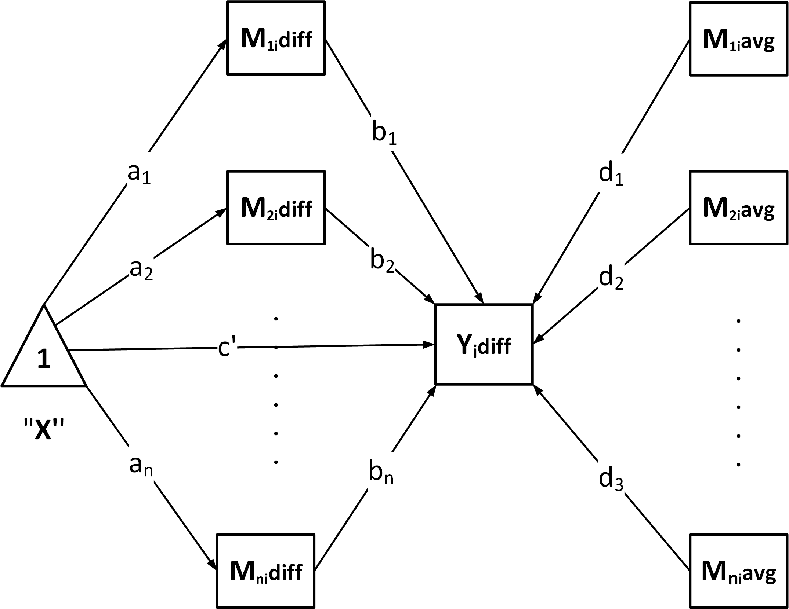

# Model equations: parallel mediation

**Purpose:** definitions and equations for `P` (parallel mediation). For
a first analysis, start with [Choose an
analysis](https://yangzhen1999.github.io/wsMed/articles/AnalysisGuide.html#choose-your-model)
or [Get
started](https://yangzhen1999.github.io/wsMed/articles/GetStarted.md).
[`GenerateModelP()`](https://yangzhen1999.github.io/wsMed/reference/GenerateModelP.md)
creates the model syntax used for this structure.

There are no directed connections among mediators.



## Difference scores and centered averages

For mediator $`i`$, $`M_{i1}`$ and $`M_{i2}`$ are its measurements in
conditions 1 and 2. Define

``` math
M_{\mathrm{diff},i}=M_{i2}-M_{i1},\qquad
\widetilde M_{\mathrm{avg},i}=\frac{M_{i1}+M_{i2}}{2},\qquad
M_{\mathrm{avg},i}=\widetilde M_{\mathrm{avg},i}-\overline{\widetilde M}_{\mathrm{avg},i}.
```

The bar denotes the sample mean used for centering. The outcome
difference is $`Y_{\mathrm{diff}}=Y_2-Y_1`$.
[`PrepareData()`](https://yangzhen1999.github.io/wsMed/reference/PrepareData.md)
constructs these variables: `diff` is not centered, whereas `avg` is
centered.

## Regression equations

The equations below show the regression part of the model without
covariates or an external moderator. All $`N`$ mediators predict the
outcome difference:

``` math
Y_{\mathrm{diff}}=c'+\sum_{i=1}^{N}\left(b_iM_{\mathrm{diff},i}+d_iM_{\mathrm{avg},i}\right)+e.
```

The mediator equations determine the structure:

``` math
M_{\mathrm{diff},i}=a_i+\epsilon_i,\qquad i=1,\ldots,N.
```

The intercepts $`a_i`$ and $`c'`$ represent direct condition effects in
their respective equations; the model syntax labels $`c'`$ as `cp`. Each
$`b_i`$ is the coefficient of a mediator difference, and $`d_i`$ is the
coefficient of its centered average. For a mediator-to-mediator
connection, $`b_{ji}`$ and $`d_{ji}`$ are the corresponding coefficients
from mediator $`j`$ to mediator $`i`$ (syntax labels `b_j_i` and
`d_j_i`).

The $`d`$ coefficients capture differences between condition-specific
slopes. The average component is not itself an external moderator.
Moderation by a separate variable $`W`$ requires specifying `W` and
`MP`.

### Relation to the two condition equations

Write the condition-specific outcome regressions as

``` math
Y_1=g_{01}+\sum_i g_{i1}M_{i1}+e_1,\qquad
Y_2=g_{02}+\sum_i g_{i2}M_{i2}+e_2.
```

Subtracting the first equation from the second gives
$`b_i=(g_{i1}+g_{i2})/2`$ and $`d_i=g_{i2}-g_{i1}`$. After centering the
averages, the intercept is

``` math
c'=g_{02}-g_{01}+\sum_i d_i\overline{\widetilde M}_{\mathrm{avg},i}.
```

Thus centering the averages changes the intercept, while preserving the
difference and average slopes.

## Indirect pathways

Every mediator has a single-mediator indirect pathway $`IE_i=a_i b_i`$.
A longer directed pathway is the product of its starting $`a`$
coefficient, its mediator-to-mediator $`b`$ coefficients and its final
outcome $`b`$ coefficient. The centered-average $`d`$ coefficients
remain in the fitted regressions but do not enter these indirect-effect
products.

For three mediators, the complete set is:

| Mediator route to Y | Indirect effect | Result identifier |
|---------------------|-----------------|-------------------|
| M1 → Y              | $`a_1 b_1`$     | `indirect_1`      |
| M2 → Y              | $`a_2 b_2`$     | `indirect_2`      |
| M3 → Y              | $`a_3 b_3`$     | `indirect_3`      |

## Total effects and contrasts

Sum every complete indirect pathway to obtain the total indirect effect:

``` math
IE_{\mathrm{total}}=\sum_{p\in\mathcal P}IE_p,\qquad
TE=c'+IE_{\mathrm{total}}.
```

Here $`\mathcal P`$ is the set of directed condition-to-outcome pathways
through one or more mediators. To compare two such pathways, define a
signed contrast:

``` math
\Delta_{p,q}=IE_p-IE_q.
```

A positive contrast means that the first indirect effect is numerically
larger; it does not necessarily have a larger absolute magnitude. For
example, $`-0.1-(-0.3)=0.2`$, although $`|-0.1|<|-0.3|`$. A contrast
estimate alone does not establish a difference. Compute its CI from the
difference of the effects within each matched joint draw, using
[`wsmed_contrasts()`](https://yangzhen1999.github.io/wsMed/reference/wsmed_contrasts.md);
do not subtract the endpoints of two separate CIs. See [Read and export
results](https://yangzhen1999.github.io/wsMed/articles/ResultsGuide.md).

## Condition-specific slopes

On the unstandardized scale, the outcome slopes in conditions 1 and 2
are

``` math
g_{i1}=b_i-d_i/2,\qquad g_{i2}=b_i+d_i/2.
```

The same relation applies to each included mediator-to-mediator
connection, using $`b_{ji}`$ and $`d_{ji}`$. These are path
coefficients, not additional indirect effects.

## Standardization and moderation

`GenerateModel*()` constructs unstandardized model syntax. With a fitted
`wsMed` result, use `summary(result, standardized = TRUE)` to request
standardized effects and paths, or set `standardized = TRUE` in
[`wsMed()`](https://yangzhen1999.github.io/wsMed/reference/wsMed.md) to
make that scale the reporting default.

Let $`s_{D M_i}`$, $`s_{A M_i}`$ and $`s_{D Y}`$ be the marginal
model-implied SDs of the mediator differences, centered averages and
outcome difference. Then

``` math
a_i^*=a_i/s_{D M_i},\quad b_i^*=b_i s_{D M_i}/s_{D Y},\quad
d_i^*=d_i s_{A M_i}/s_{D Y},\quad c'^*=c'/s_{D Y}.
```

Mediator-to-mediator slopes use the corresponding source and destination
SDs. Intermediate scales cancel in each complete indirect-effect
product, giving $`IE_p^*=IE_p/s_{D Y}`$. With moderation, evaluate the
conditional paths first: $`IE_p^*(w)=IE_p(w)/s_{D Y}`$. All moderator
values or groups share the same marginal endpoint scale. Continuous
moderator probes retain their raw units.

Standardized CIs transform coefficients and scales jointly in each draw.
Do not divide raw CI endpoints by a single fitted SD, or reconstruct
condition-specific slopes as $`b_i^*\pm d_i^*/2`$: the two standardized
coefficients use different predictor scales. See [Standardized
effects](https://yangzhen1999.github.io/wsMed/articles/StandardizedModeratedMediation.md)
for conditional effects, interaction coefficients and inference.
