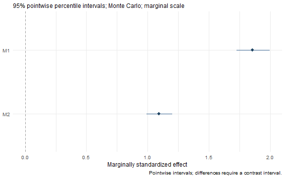
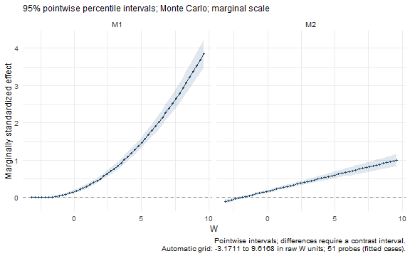
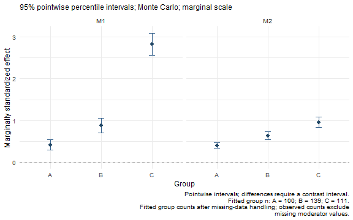
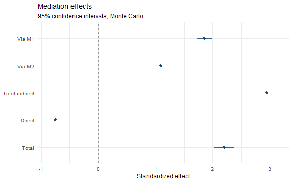
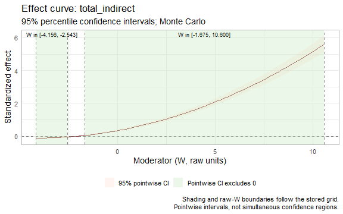
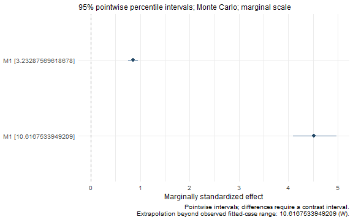

# Plotting mediation effects and contrasts

## Choose a figure

Start with a fitted `result` from the [quick
start](https://yangzhen1999.github.io/wsMed/articles/GetStarted.md).
`plot(result)` selects an indirect-effect display automatically;
`plot(summary(result))` displays all selected core effects. Both inherit
the saved standardization setting and return editable ggplots.

**Forest: compare effects and intervals**

[](#a-consistent-plot-method)

**Curve: use a continuous moderator**

[](#a-consistent-plot-method)

**Category points: compare groups**

[](#a-consistent-plot-method)

**Difference: show a contrast and its interval**

[](#differences-need-their-own-intervals)

**Recommended route:** [create the example
fits](#reproducible-two-condition-data), then use [the shared plot
method](#a-consistent-plot-method). For a custom contrast, extract it
with
[`wsmed_contrasts()`](https://yangzhen1999.github.io/wsMed/reference/wsmed_contrasts.md)
and call [`plot()`](https://rdrr.io/r/graphics/plot.default.html); the
[results
guide](https://yangzhen1999.github.io/wsMed/articles/ResultsGuide.html#compare-two-pathways)
supplies a short example.

The named plotting helpers later on this page remain available for
stored-table compatibility. They can use different bootstrap interval
conventions; review [interval conventions](#interval-conventions) before
comparing figures.

## Reproducible two-condition data

Run once: create the three example fits

``` r

set.seed(918)
n <- 350
w <- rnorm(n, 3, 2)
avg1 <- rnorm(n); avg2 <- rnorm(n)
dm1 <- 2 + .8*w + rnorm(n)
dm2 <- 1 + .4*w + .3*dm1 + rnorm(n)
dy <- .5 + .6*w + .5*dm1 + .7*dm2 + .2*dm1*w + .3*avg1 + rnorm(n)
y1 <- rnorm(n)
dat <- data.frame(
  M11=avg1-dm1/2,
  M12=avg1+dm1/2,
  M21=avg2-dm2/2,
  M22=avg2+dm2/2,
  Y1=y1,
  Y2=y1+dy,
  W=w
)
dat$Group <- cut(w, c(-Inf,2,4,Inf), labels=c("A","B","C"))
plain <- wsMed(
  data = dat,
  M_C1 = c("M11", "M21"),
  M_C2 = c("M12", "M22"),
  Y_C1 = "Y1",
  Y_C2 = "Y2",
  standardized = TRUE
)
continuous <- wsMed(
  data = dat,
  M_C1 = c("M11", "M21"),
  M_C2 = c("M12", "M22"),
  Y_C1 = "Y1",
  Y_C2 = "Y2",
  W = "W",
  MP = c("b1", "d1"),
  standardized = TRUE
)
categorical <- wsMed(
  data = dat,
  M_C1 = c("M11", "M21"),
  M_C2 = c("M12", "M22"),
  Y_C1 = "Y1",
  Y_C2 = "Y2",
  W = "Group",
  MP = c("b1", "d1"),
  standardized = TRUE
)
```

These fits request standardized output; the default
[`plot()`](https://rdrr.io/r/graphics/plot.default.html) inherits that
choice. They otherwise use the default 20,000 Monte Carlo draws. The
three fits illustrate the available displays. Grouping a continuous
moderator changes the fitted model, so the category plot represents a
separate analysis of these simulated data.

## A consistent plot method

[`plot()`](https://rdrr.io/r/graphics/plot.default.html) uses a forest
plot for ordinary effects, a continuous curve for a continuous
moderator, and category points for a categorical moderator. Specify
`view` to choose another supported display. `terms` selects effects and
their order; `labels` changes displayed names.

``` r

plot(plain)
```



plot of chunk plot-method

``` r

plot(continuous)
```



plot of chunk plot-method

``` r

plot(categorical)
```



plot of chunk plot-method

These calls use the default effect selection and plot layout. To select
or relabel effects, change the probe grid, or reorder categories,
specify the corresponding arguments explicitly:

``` r

plot(
  plain,
  terms = c("indirect_2", "indirect_1"),
  labels = c(indirect_1 = "Via M1", indirect_2 = "Via M2"),
  title = "Indirect effects"
)
plot(
  continuous,
  n = 41,
  scale = "marginal",
  terms = "indirect_1",
  title = "Conditional indirect effect",
  x_label = "W (raw units)",
  rug = TRUE
)
plot(
  categorical,
  at = list(Group = c("C", "A", "B")),
  ncol = 2,
  title = "Effects in the selected category order"
)
```

An automatic curve uses 51 equally spaced probes by default, from the
smallest to the largest finite raw moderator value among fitted cases.
For MI, the first completed dataset defines this range. The caption
reports the range and number of probes. Curves join those probes; their
bands are pointwise intervals, not simultaneous bands or exact
Johnson–Neyman regions. A forest plot of a continuous-moderator model
uses the reference value unless `at` is supplied.

`rug = TRUE` marks observed raw moderator values along a curve’s
horizontal axis. It uses fitted cases and excludes missing or imputed
moderator values, including in MI. It is available when plotting a
fitted/inference/one-call object, which retains the original data;
extracted effects alone do not contain the observations. Rug marks
describe where data occur, without changing estimates or interval
widths.

``` r

plot(
  continuous,
  view = "conditional",
  at = list(W = c(1, 3, 5)),
  terms = "indirect_1",
  title = "Effects at three raw W values"
)
```


plot of chunk selected-probes

The same methods work after a staged analysis. A fit without inference
shows point estimates only. Extracting results first is useful for
checking exactly which estimates and intervals a plot displays:

``` r

effects <- wsmed_effects(
  continuous,
  at = list(W = c(1, 3, 5)),
  terms = "indirect_1",
  scale = "marginal"
)
summary(effects)
#> wsMed indirect | marginal scale | mc 
#> 95% percentile intervals; 20000 joint draws; SE from effect draws
#> Condition contrast: C2 - C1 
#> Moderator: W in raw units; centering reference = 3.23288 
#> Standardization: effect / marginal model-implied SD(Y2 - Y1); condition contrast is unscaled.
#> Plug-in marginal outcome-difference SD: 6.28886 
#> The denominator is not a moderator-specific conditional SD.
#>                          Estimate Std. Error CI lower CI upper
#> indirect_1@1: M1 [W = 1]   0.3150     0.0314   0.2566   0.3800
#> indirect_1@2: M1 [W = 3]   0.7859     0.0486   0.6959   0.8856
#> indirect_1@3: M1 [W = 5]   1.4683     0.0749   1.3297   1.6221
#> Inference draws: 20000 retained of 20000 ; 0 excluded before effect extraction.
#> Use as.data.frame() for the full-precision table and metadata.
p <- plot(effects)
p
```


plot of chunk extraction-first

``` r

stopifnot(identical(p$data$estimate, as.data.frame(effects)$estimate),
          identical(p$data$conf.low, as.data.frame(effects)$conf.low))
```

Extracted results retain only the probes they contain; `plot(effects)`
does not add a grid. Use
[`wsmed_effects()`](https://yangzhen1999.github.io/wsMed/reference/wsmed_effects.md)
to choose different probes or a different scale.
`plot(effects, level = .90)` recalculates percentile limits from its
stored draws. `p$data` retains unrounded values; `estimate`, `conf.low`,
and `conf.high` are also available in plots produced by the named
helpers. Unknown arguments are rejected by the plot methods, so a
misspelled title is not silently ignored.

The summary uses a coefficient-style numeric table without adding
p-values. It identifies whether standard errors come from effect draws;
summaries of fits instead identify the fitted or Rubin-pooled parameter
covariance. `as.data.frame(effects)` retains the complete table and
metadata.

## Interval conventions

[`plot()`](https://rdrr.io/r/graphics/plot.default.html) uses the
percentile intervals returned by
[`wsmed_effects()`](https://yangzhen1999.github.io/wsMed/reference/wsmed_effects.md),
including when bootstrap parameter tables were requested with another
interval type. For a one-call object holding two inference methods,
specify `plot(result, method = "mc")` or
`plot(result, method = "bootstrap")`.

The named helpers preserve legacy behavior:
[`plot_effects()`](https://yangzhen1999.github.io/wsMed/reference/plot_effects.md)
uses the stored parameter-table limits, including bias-corrected
bootstrap limits if requested. Conditional and contrast helpers use
their stored percentile intervals. The subtitle identifies the
convention. A difference between a percentile interval and a
bias-corrected interval is therefore expected; it does not indicate that
plotting reran the analysis. The helpers continue to accept
`engine = "boot"`, while the plot methods use `method = "bootstrap"`.

## Optional named plotting helpers

The following sections show more explicit display settings. The generic
[`plot()`](https://rdrr.io/r/graphics/plot.default.html) calls above are
sufficient for a default figure.

## Forest plots

[`plot_effects()`](https://yangzhen1999.github.io/wsMed/reference/plot_effects.md)
displays complete indirect effects, their total, the direct effect
(`cp`) and the total effect. Choose rows and their display order with
`paths`; use a named `labels` vector for readable descriptions.

``` r

forest <- plot_effects(
  plain,
  standardized=TRUE,
  paths=c("indirect_1", "indirect_2", "total_indirect", "cp", "total_effect"),
  labels=c(indirect_1="Via M1", indirect_2="Via M2",
           total_indirect="Total indirect", cp="Direct", total_effect="Total")
)
forest
```



plot of chunk forest

With a moderator, this forest shows effects at the model reference value
(centered continuous W = 0, or the reference category). It does not
average conditional effects across W. To display different W levels, use
the next plot.

## Conditional effects by group or selected level

``` r

group_plot <- plot_conditional_effects(
  categorical,
  standardized=TRUE,
  paths=c("indirect_1","indirect_2"),
  labels=c(indirect_1="Via M1",indirect_2="Via M2"),
  ncol=2
)
group_plot
```


plot of chunk categorical-effects

Each point and interval belongs to a fitted group. There are no
interpolating lines between categories. `levels` can select and reorder
group labels. Choose `type = "paths"` for available path coefficients or
`type = "overall"` for total indirect and total effects. All panels
share their effect axis.

The same function can display the stored reference levels of a
continuous W:

``` r

plot_conditional_effects(
  continuous,
  paths="indirect_effect_1",
  levels=c("-1 SD","0 SD","+1 SD"),
  standardized=TRUE,
  labels=c(indirect_effect_1="Via M1")
)
```


plot of chunk continuous-levels

The axis includes raw W values. `indirect_1` and `indirect_effect_1` are
accepted as aliases when selecting an available indirect effect; the
underlying result tables keep their existing identifiers.

## Differences need their own intervals

One effect having an interval that excludes zero and another having an
interval that includes zero does not establish a difference between
them.
[`plot_contrasts()`](https://yangzhen1999.github.io/wsMed/reference/plot_contrasts.md)
displays the difference and its own interval instead.

``` r

contrast_plot <- plot_contrasts(
  categorical,
  standardized=TRUE,
  paths=c("indirect_1","indirect_2"),
  labels=c(indirect_1="Via M1",indirect_2="Via M2"),
  ncol=2
)
contrast_plot
```


plot of chunk categorical-contrasts

For example, `B - A` means the conditional effect in B minus that in A.
With a continuous moderator, the same function compares stored low, mean
and high moderator levels. `contrasts` selects exact labels from the
result table (also visible in `contrast_plot$data$Contrast`).
Conditional contrasts use the already-computed joint-draw contrast
intervals, not differences between endpoints of separate intervals.

Without a moderator, the plot compares indirect paths with one another:

``` r

plot_contrasts(
  plain,
  standardized=TRUE
)
```


plot of chunk path-contrasts

Here the helper uses stored joint draws and fitted/pooled point
estimates. Standardized contrasts are computed with each draw’s own
endpoint scales before forming percentile intervals. No model is
refitted. A moderator fit currently supports contrasts within each
effect across groups/levels, not arbitrary contrasts between different
indirect paths at a fixed W. For continuous moderators,
`type = "overall"` is unavailable unless an overall contrast table is
present; specific indirect and path contrasts remain available.

## Conditional curves and their highlighted ranges

``` r

plot_moderation_curve(
  continuous,
  "total_indirect",
  standardized=TRUE
)
```



plot of chunk curve

The band uses the fitted confidence level. Shading denotes stored grid
values whose pointwise interval excludes zero. Labels give raw W bounds,
not sample percentiles. Boundaries are grid approximations; they are not
exact Johnson–Neyman boundaries or simultaneous confidence regions. An
adjacent change from a negative to a positive interval breaks a
highlighted range.

## Inspect and export

The [`plot()`](https://rdrr.io/r/graphics/plot.default.html) methods
retain descriptive data-support information. Continuous probes outside
the observed fitted-case moderator range issue a warning when effects
are extracted and remain marked in the table and plot caption. This is a
marginal-range check, not a test of joint covariate overlap or density.
Imputed moderator values do not extend the observed range.

``` r

probe_values <- c(mean(dat$W), max(dat$W) + 1)
supported <- wsmed_effects(
  continuous,
  at = list(W = probe_values),
  terms = "indirect_1"
)
#> Warning: Moderator probes outside the observed fitted-case range of W
#> [-3.17113, 9.61675]: 10.6168. These estimates extrapolate.
as.data.frame(supported)[, c("at", "estimate", "extrapolated")]
#>                 at  estimate extrapolated
#> 1 3.23287569618678 0.8544881        FALSE
#> 2 10.6167533949209 4.5160206         TRUE
plot(
  supported,
  view = "forest"
)
```



plot of chunk support

The warning above is intentional. Plotting the extracted object again
does not repeat the warning or resample.
`attr(plot(supported), "wsmed_plot")$support` records its observed
range. Category plots report fitted group counts; MI captions report the
minimum and maximum across completed datasets. The table also
distinguishes observed memberships (`n.observed`) from fitted counts.
These counts are not effective sample sizes for the conditional effects.

``` r

forest$data[, c("Path","Estimate","CI.LL","CI.UL")]
#>              Path   Estimate      CI.LL      CI.UL
#> 16     indirect_1  1.8547450  1.7245090  1.9947929
#> 17     indirect_2  1.0906147  0.9886189  1.2001530
#> 18 total_indirect  2.9453597  2.7775256  3.1314103
#> 1              cp -0.7473749 -0.8631387 -0.6263901
#> 19   total_effect  2.1979847  2.0338324  2.3755229
attr(forest, "wsmed_plot")
#> $engine
#> [1] "mc"
#> 
#> $standardized
#> [1] TRUE
#> 
#> $level
#> [1] 0.95
```

``` r

ggplot2::ggsave(
  "mediation-effects.pdf",
  forest,
  width=8,
  height=5
)
ggplot2::ggsave(
  "group-effects.png",
  group_plot,
  width=8,
  height=5,
  dpi=300
)
```

All conditional intervals are percentile intervals; bootstrap parameter
forest plots use the stored bootstrap interval type. The common marginal
scale, fixed raw W probes and joint uncertainty are described in
[Standardized moderated
mediation](https://yangzhen1999.github.io/wsMed/articles/StandardizedModeratedMediation.md).
