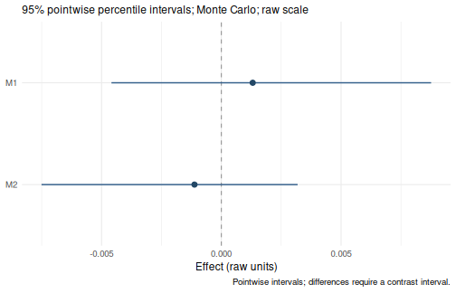

# Analysis options: a complete walkthrough

Use the [Get started
examples](https://yangzhen1999.github.io/wsMed/articles/GetStarted.md)
for a first analysis. This guide shows which arguments to add when your
question needs a different model, covariates, missing-data handling or
inference method.

## Start with the defaults

``` r

data(example_data)
result <- wsMed(
  data = example_data,
  M_C1 = c("A1", "B1"),
  M_C2 = c("A2", "B2"),
  Y_C1 = "D1",
  Y_C2 = "D2"
)
print(result)
#> wsMed analysis
#> Model: P | DE | Observations: 100 
#> Effects:
#> wsMed all | raw scale | mc 
#> 95% percentile intervals; 20000 joint draws; SE from effect draws
#> Condition contrast: C2 - C1 
#>                                        Estimate Std. Error  CI lower  CI upper
#> cp: Direct effect                     -0.031795   0.017000 -0.064525  0.001864
#> indirect_1: M1                         0.001311   0.003208 -0.004586  0.008760
#> indirect_2: M2                        -0.001120   0.002587 -0.007507  0.003186
#> total_indirect: Total indirect effect  0.000191   0.004138 -0.008459  0.008723
#> total: Total effect                   -0.031604   0.017049 -0.064633  0.001895
#> Inference draws: 20000 retained of 20000 ; 0 excluded before effect extraction.
#> Use as.data.frame() for the full-precision table and metadata.
#> Post-fit admissibility: 1 of 1 ; excluded rows: 0
```

The default is parallel mediation with Monte Carlo inference, 20,000
draws, 95% CIs and unstandardized output. Listwise deletion is the
default missing-data strategy; the example data are complete. Later
calls keep these defaults unless an argument is explicitly changed.

## Paired variables

Each row represents one participant. Match each mediator’s condition 1
and condition 2 measurements by position in `M_C1` and `M_C2`. `Y_C1`
and `Y_C2` identify the outcome pair. Differences are always **condition
2 minus condition 1**.

| Construct | Condition 1 | Condition 2 | Role                   |
|-----------|-------------|-------------|------------------------|
| A         | `A1`        | `A2`        | First mediator (`M1`)  |
| B         | `B1`        | `B2`        | Second mediator (`M2`) |
| D         | `D1`        | `D2`        | Outcome (`Y`)          |

Outcomes, mediators and within-subject covariates are analyzed as
continuous numeric variables. Binary and multicategory variables can be
between-subject covariates or moderators; use unordered factors with
explicit levels. See [categorical
predictors](https://yangzhen1999.github.io/wsMed/articles/CategoricalPredictors.md).

## Choose the mediator structure

### Predefined models

| `form` | Structure |
|----|----|
| `"P"` (default) | Parallel mediation |
| `"CN"` | Serial mediation; each mediator predicts every later mediator |
| `"CP"` | Serial-parallel mediation; M1 predicts the remaining mediators |
| `"PC"` | Parallel-serial mediation; the remaining mediators predict M1 |

The diagrams show the four predefined structures. Each includes
condition effects on every mediator and the outcome, and paths from
every mediator to the outcome. The connections among mediators
distinguish the models.

**P: Parallel**

[](https://yangzhen1999.github.io/wsMed/articles/Wa.png)

No directed connections among mediators. [Model
equations](https://yangzhen1999.github.io/wsMed/articles/GenerateModelP.md).

**CN: Serial**

[](https://yangzhen1999.github.io/wsMed/articles/Wb.png)

Each earlier mediator predicts every later mediator. [Model
equations](https://yangzhen1999.github.io/wsMed/articles/GenerateModelCN.md).

**CP: Serial-parallel**

[](https://yangzhen1999.github.io/wsMed/articles/Wc.png)

M1 predicts M2, M3, and so on. [Model
equations](https://yangzhen1999.github.io/wsMed/articles/GenerateModelCP.md).

**PC: Parallel-serial**

[](https://yangzhen1999.github.io/wsMed/articles/Wd.png)

M2, M3, and so on predict M1. [Model
equations](https://yangzhen1999.github.io/wsMed/articles/GenerateModelPC.md).

Click a diagram to enlarge it. In these difference-score diagrams,
`diff` denotes condition 2 minus condition 1 and `avg` denotes the
centered average; the triangle represents the constant used to estimate
condition effects.

For example, change only `form` to fit a serial model:

``` r

serial <- wsMed(
  data = example_data,
  M_C1 = c("A1", "B1"),
  M_C2 = c("A2", "B2"),
  Y_C1 = "D1",
  Y_C2 = "D2",
  form = "CN"
)
print(serial)
```

Choose mediator order from the research design. The model articles show
the
[parallel](https://yangzhen1999.github.io/wsMed/articles/GenerateModelP.md),
[serial](https://yangzhen1999.github.io/wsMed/articles/GenerateModelCN.md),
[serial-parallel](https://yangzhen1999.github.io/wsMed/articles/GenerateModelCP.md)
and
[parallel-serial](https://yangzhen1999.github.io/wsMed/articles/GenerateModelPC.md)
equations and diagrams.

### User-defined models

Use `form = "UD"` when you want to specify the mediator connections
yourself. Mediator labels follow the order in `M_C1` and `M_C2`: in the
call below, `M1` is A, `M2` is B, and `M3` is C. `Y` is the outcome pair
D1/D2. In `paths`, write one arrow per string using these labels:

``` r

custom_paths <- c(
  "M1 -> M3",  # A predicts C
  "M3 -> Y",   # C predicts the outcome
  "M2 -> Y"    # B predicts the outcome
)
```

Pass this vector to
[`wsMed()`](https://yangzhen1999.github.io/wsMed/reference/wsMed.md);
all other settings keep their defaults:

``` r

custom <- wsMed(
  data = example_data,
  M_C1 = c("A1", "B1", "C1"),
  M_C2 = c("A2", "B2", "C2"),
  Y_C1 = "D1",
  Y_C2 = "D2",
  form = "UD",
  paths = custom_paths
)
print(custom)
#> wsMed analysis
#> Model: UD | DE | Observations: 100 
#> Effects:
#> wsMed all | raw scale | mc 
#> 95% percentile intervals; 20000 joint draws; SE from effect draws
#> Condition contrast: C2 - C1 
#>                                        Estimate Std. Error  CI lower  CI upper
#> cp: Direct effect                     -3.00e-02   1.68e-02 -6.31e-02  2.90e-03
#> indirect_1_3: M1 -> M3                -2.25e-05   3.63e-04 -8.44e-04  7.36e-04
#> indirect_2: M2                        -1.40e-03   2.75e-03 -8.43e-03  2.98e-03
#> indirect_3: M3                        -1.85e-04   2.17e-03 -5.11e-03  4.38e-03
#> total_indirect: Total indirect effect -1.60e-03   3.55e-03 -9.76e-03  4.94e-03
#> total: Total effect                   -3.16e-02   1.69e-02 -6.48e-02  1.55e-03
#> Inference draws: 20000 retained of 20000 ; 0 excluded before effect extraction.
#> Use as.data.frame() for the full-precision table and metadata.
#> Post-fit admissibility: 1 of 1 ; excluded rows: 0
```

Only the specified mediator connections are fitted. For example,
`M1 -> Y` is absent here; add that string to `custom_paths` if the model
should include it. Paths from the condition to every mediator and the
direct condition-to-outcome path are added automatically, so do not
include `X` in `paths`.

The arrows must not form a cycle, and at least one must end at `Y`. The
[worked UD
example](https://yangzhen1999.github.io/wsMed/articles/GenerateModelCustom.md)
explains these rules and shows how the specified arrows determine the
indirect effects.

To add moderation, keep `custom_paths` and add `W = "D3"` and
`MP = c("b_1_3", "b3")`. This selects the M1-to-M3 and M3-to-outcome
slopes for moderation by D3. Unlike `paths`, `MP` takes coefficient
labels, not arrow strings. See the [UD moderation
example](https://yangzhen1999.github.io/wsMed/articles/GenerateModelCustom.html#add-a-moderator)
for the full call, path-label choices, and conditional results.

## Add optional model components

### Covariates

Use `C_C1` and `C_C2` for paired within-subject covariates and `C` for
between-subject covariates. Their measurements remain in the same wide
dataset:

``` r

adjusted <- wsMed(
  data = example_data,
  M_C1 = c("A1", "B1"),
  M_C2 = c("A2", "B2"),
  Y_C1 = "D1",
  Y_C2 = "D2",
  C_C1 = "C1",
  C_C2 = "C2",
  C = "D3"
)
print(adjusted)
```

### Moderators

Use `W` for the moderator column and `MP` for the paths to moderate. In
the parallel model, `b1` and `b2` are the mediator-to-outcome difference
slopes:

``` r

moderated <- wsMed(
  data = example_data,
  M_C1 = c("A1", "B1"),
  M_C2 = c("A2", "B2"),
  Y_C1 = "D1",
  Y_C2 = "D2",
  W = "D3",
  MP = c("b1", "b2")
)
print(moderated)
plot(moderated)
```

Moderator main effects enter the difference equations automatically. For
a continuous moderator, the default report uses the centering reference,
whereas the default plot shows curves over the observed range. These two
displays answer different questions. The second [Get started
example](https://yangzhen1999.github.io/wsMed/articles/GetStarted.html#example-2-add-a-continuous-moderator)
shows both outputs. Use `at` only to request particular raw moderator
values.

For a categorical moderator, declare an unordered factor, choose its
reference level, and pass its column name to `W`. See the [categorical
example](https://yangzhen1999.github.io/wsMed/articles/CategoricalPredictors.html#fit-categorical-moderated-mediation).

## Missing data and confidence intervals

### Choose a missing-data strategy

| `Na` | Data handling | Available CI methods |
|----|----|----|
| `"DE"` (default) | Listwise deletion | Monte Carlo or bootstrap |
| `"FIML"` | Full-information maximum likelihood | Monte Carlo or bootstrap |
| `"MI"` | Multiple imputation | Monte Carlo |

To illustrate these choices, remove a few simulated post-condition
measurements:

``` r

incomplete <- example_data
incomplete$A2[1:5] <- NA
incomplete$D2[6:10] <- NA
```

Add `Na = "FIML"` when you want FIML:

``` r

fiml_result <- wsMed(
  data = incomplete,
  M_C1 = c("A1", "B1"),
  M_C2 = c("A2", "B2"),
  Y_C1 = "D1",
  Y_C2 = "D2",
  Na = "FIML"
)
print(fiml_result)
```

Use `Na = "MI"` for multiple imputation. The default uses five
predictive mean matching imputations for the numeric variables in this
example:

``` r

mi_result <- wsMed(
  data = incomplete,
  M_C1 = c("A1", "B1"),
  M_C2 = c("A2", "B2"),
  Y_C1 = "D1",
  Y_C2 = "D2",
  Na = "MI"
)
print(mi_result)
```

For finer control, `mi_args` accepts imputation settings; for example,
`mi_args = list(m = 20)` requests 20 imputations. Select the imputation
method and number of imputations for your data and analysis.

MI imputes the original measurements before constructing analysis
variables within each completed dataset. FIML handles missing analysis
variables during fitting, after differences, averages and interactions
have been constructed. FIML requires categorical predictors to be fully
observed.

Choose a strategy that is appropriate for the missing-data assumptions
and variable roles. With moderation, default main-effects imputation may
not preserve the substantive interactions; see [model-compatible
imputation](https://yangzhen1999.github.io/wsMed/articles/CompatibleImputation.md).

### Choose the inference method

Monte Carlo is the default. To combine FIML with bootstrap CIs, specify
both `Na` and `ci_method`. This executed example uses the incomplete
data above and the default 2,000 bootstrap replicates:

``` r

boot_result <- wsMed(
  data = incomplete,
  M_C1 = c("A1", "B1"),
  M_C2 = c("A2", "B2"),
  Y_C1 = "D1",
  Y_C2 = "D2",
  Na = "FIML",
  ci_method = "bootstrap"
)
print(boot_result)
#> wsMed analysis
#> Model: P | FIML | Observations: 100 
#> Effects:
#> wsMed all | raw scale | bootstrap 
#> 95% percentile intervals; 2000 joint draws; SE from effect draws
#> Condition contrast: C2 - C1 
#>                                        Estimate Std. Error  CI lower  CI upper
#> cp: Direct effect                     -0.028639   0.017200 -0.062908  0.005576
#> indirect_1: M1                        -0.000828   0.003209 -0.008216  0.005280
#> indirect_2: M2                        -0.001846   0.003449 -0.010600  0.003383
#> total_indirect: Total indirect effect -0.002673   0.004737 -0.013825  0.005631
#> total: Total effect                   -0.031313   0.017464 -0.066589  0.003270
#> Inference draws: 2000 retained of 2000 ; 0 excluded before effect extraction.
#> Use as.data.frame() for the full-precision table and metadata.
#> Post-fit admissibility: 1 of 1 ; excluded rows: 0
```

When one member of a measurement pair is missing, its difference and
average are missing too. FIML handles these constructed variables during
fitting; the observed member of the original pair is not separately
included in this model. The bootstrap resamples participant rows of the
constructed analysis data, retaining the within-participant pairing and
fitting each sample with FIML. For complete data or listwise deletion,
omit `Na = "FIML"` from this call.

`R` controls Monte Carlo draws, `bootstrap` controls bootstrap
replicates, and `alpha` controls the confidence level as `1 - alpha`.
`seed` and `iseed` control the Monte Carlo and bootstrap random draws,
respectively. `ci_method = "both"` retains both inference engines;
[`print()`](https://rdrr.io/r/base/print.html) then reports them
separately. MI currently supports Monte Carlo only.

## Standardized effects

The default output is unstandardized. Add `standardized = TRUE` to the
analysis to save standardized reporting as its default, or request it
for one summary:

``` r

summary(
  result,
  standardized = TRUE
)
#> wsMed statistical summary
#> Model: P | Missing: DE | Observations: 100 
#> Effects:
#> wsMed all | marginal scale | mc 
#> 95% percentile intervals; 20000 joint draws; SE from effect draws
#> Condition contrast: C2 - C1 
#> Standardization: effect / marginal model-implied SD(D2 - D1); condition contrast is unscaled.
#> Plug-in marginal outcome-difference SD: 0.169239 
#> The denominator is not a moderator-specific conditional SD.
#>                                       Estimate Std. Error CI lower CI upper
#> cp: Direct effect                     -0.18787    0.10030 -0.38339  0.01074
#> indirect_1: M1                         0.00775    0.01858 -0.02663  0.05041
#> indirect_2: M2                        -0.00662    0.01496 -0.04328  0.01832
#> total_indirect: Total indirect effect  0.00113    0.02396 -0.04869  0.05065
#> total: Total effect                   -0.18674    0.10059 -0.38126  0.01122
#> Inference draws: 20000 retained of 20000 ; 0 excluded before effect extraction.
#> Use as.data.frame() for the full-precision table and metadata.
#> 
#> Path coefficients:
#>    Estimate Std. Error CI lower CI upper
#> cp  -0.1879     0.1003  -0.3834   0.0107
#> b1  -0.0501     0.0972  -0.2385   0.1429
#> d1  -0.0751     0.1012  -0.2706   0.1284
#> b2  -0.0821     0.0975  -0.2709   0.1096
#> d2  -0.0438     0.1015  -0.2421   0.1557
#> a1  -0.1546     0.1027  -0.3589   0.0462
#> a2   0.0806     0.1011  -0.1153   0.2784
#> Post-fit admissibility: 1 of 1 ; excluded rows: 0 
#> Tables: $effects, $coefficients; analysis settings: $info.
```

Changing the reporting scale does not fit a new model. Standardized CIs
propagate uncertainty in the coefficients and model-implied scales; they
are not obtained by dividing the unstandardized CI endpoints by a single
fitted SD. See [standardized
effects](https://yangzhen1999.github.io/wsMed/articles/StandardizedModeratedMediation.md).

## Inspect and present the results

``` r

summary(result)
#> wsMed statistical summary
#> Model: P | Missing: DE | Observations: 100 
#> Effects:
#> wsMed all | raw scale | mc 
#> 95% percentile intervals; 20000 joint draws; SE from effect draws
#> Condition contrast: C2 - C1 
#>                                        Estimate Std. Error  CI lower  CI upper
#> cp: Direct effect                     -0.031795   0.017000 -0.064525  0.001864
#> indirect_1: M1                         0.001311   0.003208 -0.004586  0.008760
#> indirect_2: M2                        -0.001120   0.002587 -0.007507  0.003186
#> total_indirect: Total indirect effect  0.000191   0.004138 -0.008459  0.008723
#> total: Total effect                   -0.031604   0.017049 -0.064633  0.001895
#> Inference draws: 20000 retained of 20000 ; 0 excluded before effect extraction.
#> Use as.data.frame() for the full-precision table and metadata.
#> 
#> Path coefficients:
#>    Estimate Std. Error CI lower CI upper
#> cp -0.03180    0.01700 -0.06453  0.00186
#> b1 -0.04834    0.09555 -0.23422  0.13918
#> d1 -0.06905    0.09508 -0.25500  0.11962
#> b2 -0.07732    0.09387 -0.26459  0.10461
#> d2 -0.03676    0.08692 -0.20737  0.13289
#> a1 -0.02712    0.01772 -0.06162  0.00817
#> a2  0.01448    0.01796 -0.02032  0.04929
#> Post-fit admissibility: 1 of 1 ; excluded rows: 0 
#> Tables: $effects, $coefficients; analysis settings: $info.
plot(result)
```



plot of chunk results

Use `print(result)` for the core report and `summary(result)` for a
structured statistical summary. Their default displays can be read
directly. Numerical extraction, selected moderator values and export are
optional next steps in [Read and export
results](https://yangzhen1999.github.io/wsMed/articles/ResultsGuide.md).

For generated model syntax, use `printGM(result)`. For separate model
specification, fitting, inspection and inference, use the [staged
workflow](https://yangzhen1999.github.io/wsMed/articles/ModularWorkflow.md).

## Manuscript data

The package also includes the empirical dataset used in the paper:

``` r

data(wsmed_examples)
dim(wsmed_examples)
#> [1] 123  14
```

It contains 123 intervention-group participants and retains the original
missing values. Its help page documents the study, processing, variable
definitions and license. The examples on this page use simulated data to
teach analysis choices; the paper’s replication materials record the
full settings and computing environment for its numerical results.
