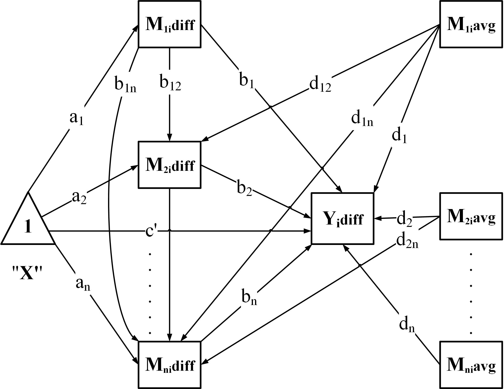
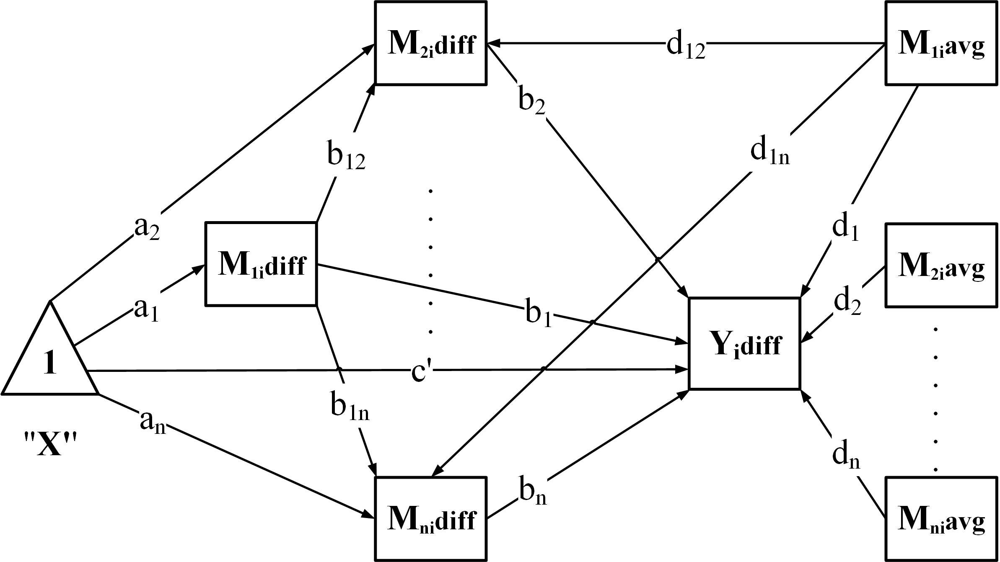
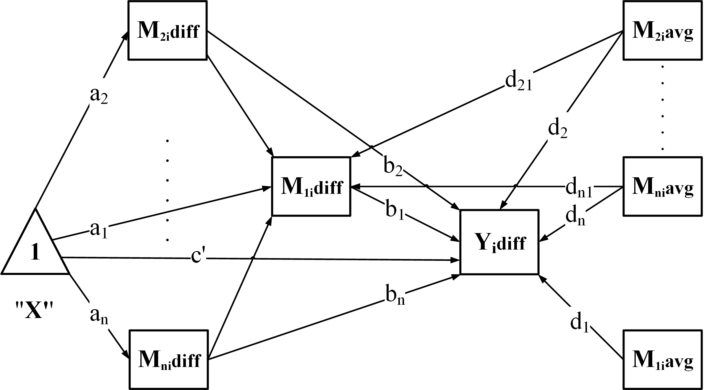

Start with your research question, then follow the relevant guide. For a first
analysis, complete [Get started](GetStarted.html); it uses `wsMed()` throughout.
All models here require two within-subject conditions with paired measurements.

## Prepare your data

Use one row per participant, separate columns for the two conditions, and the
same mediator order in both conditions. Decide which condition is subtracted
from which before fitting: wsMed uses **condition 2 minus condition 1**.

- **Column layout:** [a small worked example](GetStarted.html#match-your-columns-to-the-two-conditions).
- **Within- and between-subject covariates:** [analysis options](WsMed.html#covariates).
- **Category coding and reference groups:** [categorical predictors](CategoricalPredictors.html).

## Choose your model

| Research structure | `form` | Meaning / next step |
|---|---|---|
| Parallel pathways | `"P"` | Each mediator forms a separate pathway; start with the [quick start](GetStarted.html). |
| Serial pathways | `"CN"` | Each mediator predicts every later mediator in the supplied order. |
| Serial-parallel structure | `"CP"` | The first mediator (`M1`) predicts all remaining mediators. |
| Parallel-serial structure | `"PC"` | All remaining mediators predict the first mediator (`M1`). |
| User-defined pathways | `"UD"` | Set `form = "UD"` and list each mediator-to-mediator or mediator-to-outcome arrow in `paths`; see the example below. |

The four predefined models are shown below. Each includes paths from the
condition to every mediator and to the outcome, and from every mediator to the
outcome. Choose the structure and mediator order from your research design;
`CP` and `PC` place `M1` at opposite ends of the mediator connections.

<div class="wsmed-plot-grid" style="grid-template-columns: repeat(auto-fit, minmax(min(100%, 300px), 1fr));">
<div class="wsmed-plot-card">
<p><strong>P: Parallel</strong></p>
<a href="Wa.png"></a>
<p>No directed connections among mediators. <a href="GenerateModelP.html">Model equations</a>.</p>
</div>
<div class="wsmed-plot-card">
<p><strong>CN: Serial</strong></p>
<a href="Wb.png"></a>
<p>Each earlier mediator predicts every later mediator. <a href="GenerateModelCN.html">Model equations</a>.</p>
</div>
<div class="wsmed-plot-card">
<p><strong>CP: Serial-parallel</strong></p>
<a href="Wc.png"></a>
<p>M1 predicts M2, M3, and so on. <a href="GenerateModelCP.html">Model equations</a>.</p>
</div>
<div class="wsmed-plot-card">
<p><strong>PC: Parallel-serial</strong></p>
<a href="Wd.png"></a>
<p>M2, M3, and so on predict M1. <a href="GenerateModelPC.html">Model equations</a>.</p>
</div>
</div>

Click a diagram to enlarge it. In these difference-score diagrams, `diff`
denotes condition 2 minus condition 1 and `avg` denotes the centered average;
the triangle represents the constant used to estimate condition effects.

For **user-defined models**, `M1`, `M2`, and so on refer to the positions in
`M_C1` and `M_C2`; `Y` refers to the pair supplied through `Y_C1` and `Y_C2`.
For example, with `M_C1 = c("A1", "B1", "C1")` and
`M_C2 = c("A2", "B2", "C2")`, the following specifies A to C, C to the
outcome, and B to the outcome:


``` r
custom_paths <- c(
  "M1 -> M3",  # A to C
  "M3 -> Y",   # C to the outcome
  "M2 -> Y"    # B to the outcome
)
```

Pass this vector as `paths = custom_paths` together with `form = "UD"` in
`wsMed()`. Write one arrow per string using these model labels, not the raw
column names. Only the listed mediator connections are included: this example
omits `M1 -> Y`. Condition-to-mediator paths and the direct condition-to-outcome
path are added automatically. The [worked UD example](GenerateModelCustom.html)
shows the complete call, input rules, and resulting indirect effects.

To add a moderator to this UD model, keep `custom_paths` and add
`W = "D3"` and `MP = c("b_1_3", "b3")` to the call. Here, D3 is the
moderator column; `b_1_3` and `b3` select the M1-to-M3 and M3-to-outcome
slopes. Use coefficient labels in `MP`, not the arrow strings used in `paths`.
The [UD moderation example](GenerateModelCustom.html#add-a-moderator)
shows the complete call, how to choose other paths, and how to read
conditional effects at selected moderator values.

## Add moderation

| Moderator | Guide | What to report |
|---|---|---|
| Continuous | [Specify moderated paths](WsMed.html#moderators) | Conditional effects at meaningful raw values, with a [curve or selected-level plot](PlottingEffects.html). |
| Categorical | [Fit and compare groups](CategoricalPredictors.html#fit-categorical-moderated-mediation) | Reference coding, group-specific effects and intervals for group differences. |

Declare categorical between-subject covariates and moderators as unordered
factors before using either interface. Set factor levels explicitly; the first
level is the reference group. The [categorical predictor guide](CategoricalPredictors.html)
shows binary and multicategory coding. Specify which paths are moderated rather
than assuming that every path includes an interaction.

## Handle missing data

| Situation | Where to start |
|---|---|
| Complete data or deliberate complete-case analysis | `Na = "DE"`; inspect the number of retained participants. |
| Full-information maximum likelihood | `Na = "FIML"`; see [options and restrictions](WsMed.html#missing-data-and-confidence-intervals). |
| Multiple imputation | `Na = "MI"`; see [imputation options](WsMed.html#missing-data-and-confidence-intervals). |
| Multiple imputation with moderation interactions | [Model-compatible imputation](CompatibleImputation.html), including external completed datasets. |

The choice depends on the missing-data assumptions and variable types.
Default main-effects imputation may not preserve moderation interactions.
Do not treat successful fitting or reproducible output as proof that an
imputation model is suitable. Missing categorical predictors have additional
[restrictions](CategoricalPredictors.html#missing-categorical-predictors).

## Read, compare and present results

- [Read and export results](ResultsGuide.html): all core effects in one table.
- [Standardized effects](StandardizedModeratedMediation.html): with or without moderation.
- [Plot gallery](PlottingEffects.html): forest plots, curves, group effects and differences.

## Go further when you need it

| Task | Guide |
|---|---|
| Specify, fit, infer, and inspect or extract at each stage | [Staged workflow](ModularWorkflow.html) |
| Inspect generated SEM syntax | [Model syntax](printGM.html) |
| Check warnings, diagnostics and reproducibility | [Diagnostics and migration](WorkflowReliability.html) |
| Read mathematical definitions and software comparisons | [All articles](index.html) |

**Next:** [run a first analysis](GetStarted.html) or [read its results](ResultsGuide.html).
