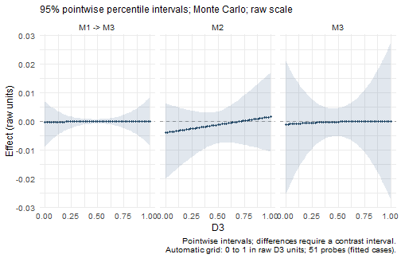

Use `wsMed(form = "UD", paths = ...)` when the mediator connections do not
match a predefined model. Supply paired raw measurements, then list the
arrows among mediators and from mediators to the outcome. This tutorial uses
the package's simulated data and the default inference and reporting settings.


``` r
data(example_data)
```

## Mediator numbering

Mediator labels are assigned according to the order of the variables supplied
to `M_C1` and `M_C2`. For example:

| Construct | Condition 1 | Condition 2 | Model label |
|:----------|:------------|:------------|:------------|
| A         | `A1`        | `A2`        | `M1`        |
| B         | `B1`        | `B2`        | `M2`        |
| C         | `C1`        | `C2`        | `M3`        |
| D         | `D1`        | `D2`        | `Y`         |

Therefore, `"M1 -> M3"` represents a path from construct A to construct C.
Mediator numbering identifies variables; it does not determine path direction.

## Specifying a custom model

Write one directed connection per string in `paths`. Use the model labels
`M1`, `M2`, and so on, plus `Y`, rather than raw column names such as `A1`.
For example, to connect A to C, C to the outcome, and B to the outcome:


``` r
custom_paths <- c(
  "M1 -> M3",  # A to C
  "M3 -> Y",   # C to the outcome
  "M2 -> Y"    # B to the outcome
)
```

| Entry in `paths` | Connection in this example |
|---|---|
| `"M1 -> M3"` | A predicts C |
| `"M3 -> Y"` | C predicts the outcome D |
| `"M2 -> Y"` | B predicts the outcome D |

Each string represents one arrow, not a complete mediation route. For
example, specify `"M1 -> M3"` and `"M3 -> Y"` separately instead of writing
`"M1 -> M3 -> Y"`. Spaces around `->` are optional.

Only the listed mediator connections are included. In this example there
is no direct path from M1 to Y, and no directed path between M1 and M2.
Paths from the condition to **every mediator**, and the direct path from
the condition to the outcome, are added automatically. Do not add `X` to
the path vector.

## Fitting the complete model with wsMed

Pass the path vector to `wsMed()` along with the paired measurements:


``` r
result_custom <- wsMed(
  data = example_data,
  M_C1 = c("A1", "B1", "C1"),
  M_C2 = c("A2", "B2", "C2"),
  Y_C1 = "D1",
  Y_C2 = "D2",
  form = "UD",
  paths = custom_paths
)
print(result_custom)
#> wsMed analysis
#> Model: UD | DE | Observations: 100 
#> Effects:
#> wsMed all | raw scale | mc 
#> 95% percentile intervals; 20000 joint draws; SE from effect draws
#> Condition contrast: C2 - C1 
#>                                        Estimate Std. Error  CI lower  CI upper
#> cp: Direct effect                     -3.00e-02   1.68e-02 -6.31e-02  2.90e-03
#> indirect_1_3: M1 -> M3                -2.25e-05   3.63e-04 -8.44e-04  7.36e-04
#> indirect_2: M2                        -1.40e-03   2.75e-03 -8.43e-03  2.98e-03
#> indirect_3: M3                        -1.85e-04   2.17e-03 -5.11e-03  4.38e-03
#> total_indirect: Total indirect effect -1.60e-03   3.55e-03 -9.76e-03  4.94e-03
#> total: Total effect                   -3.16e-02   1.69e-02 -6.48e-02  1.55e-03
#> Inference draws: 20000 retained of 20000 ; 0 excluded before effect extraction.
#> Use as.data.frame() for the full-precision table and metadata.
#> Post-fit admissibility: 1 of 1 ; excluded rows: 0
```

This call uses the default Monte Carlo CIs and unstandardized output.
Use the usual summary method for effect and path-coefficient tables:


``` r
summary(result_custom)
#> wsMed statistical summary
#> Model: UD | Missing: DE | Observations: 100 
#> Effects:
#> wsMed all | raw scale | mc 
#> 95% percentile intervals; 20000 joint draws; SE from effect draws
#> Condition contrast: C2 - C1 
#>                                        Estimate Std. Error  CI lower  CI upper
#> cp: Direct effect                     -3.00e-02   1.68e-02 -6.31e-02  2.90e-03
#> indirect_1_3: M1 -> M3                -2.25e-05   3.63e-04 -8.44e-04  7.36e-04
#> indirect_2: M2                        -1.40e-03   2.75e-03 -8.43e-03  2.98e-03
#> indirect_3: M3                        -1.85e-04   2.17e-03 -5.11e-03  4.38e-03
#> total_indirect: Total indirect effect -1.60e-03   3.55e-03 -9.76e-03  4.94e-03
#> total: Total effect                   -3.16e-02   1.69e-02 -6.48e-02  1.55e-03
#> Inference draws: 20000 retained of 20000 ; 0 excluded before effect extraction.
#> Use as.data.frame() for the full-precision table and metadata.
#> 
#> Path coefficients:
#>       Estimate Std. Error CI lower CI upper
#> cp    -0.03000    0.01684 -0.06307  0.00290
#> b2    -0.09632    0.09303 -0.27662  0.08915
#> d2    -0.01377    0.08708 -0.18534  0.15458
#> b3    -0.01350    0.10245 -0.21287  0.18842
#> d3    -0.16325    0.10038 -0.35988  0.03574
#> a1    -0.02712    0.01757 -0.06152  0.00743
#> a2     0.01448    0.01798 -0.02044  0.04994
#> a3     0.01368    0.01641 -0.01819  0.04573
#> b_1_3 -0.06142    0.09198 -0.23967  0.12025
#> d_1_3 -0.07843    0.08705 -0.24852  0.09208
#> Post-fit admissibility: 1 of 1 ; excluded rows: 0 
#> Tables: $effects, $coefficients; analysis settings: $info.
```

To include a direct M1-to-outcome connection, add its arrow to the vector:


``` r
expanded_paths <- c(
  custom_paths,
  "M1 -> Y"
)
```

Refit the same call with `paths = expanded_paths` to include that connection.
This changes the fitted model and adds the indirect route through M1 alone.

## Input requirements

- Reference only mediator labels defined by the supplied column pairs.
- Use one arrow per string, starting at a mediator and ending at another
  mediator or `Y`. At least one arrow must end at `Y`.
- Do not repeat an arrow or use a self-loop such as `"M1 -> M1"`.
- Do not create a cycle, such as both `"M1 -> M2"` and `"M2 -> M1"`.

Every mediator intended to contribute an indirect effect needs a route to
`Y`, either directly or through other mediators. The package warns if a
supplied mediator has no such route.

## Indirect effects

`wsMed()` identifies all indirect routes implied by the specified arrows.
In the following notation, `X` denotes the within-subject condition; it is
not an entry to add to `paths`.
The model defined by `custom_paths` contains three indirect effects:

| Route | Parameter label | Product |
|---|---|---|
| `X -> M1 -> M3 -> Y` | `indirect_1_3` | `a1 * b_1_3 * b3` |
| `X -> M2 -> Y` | `indirect_2` | `a2 * b2` |
| `X -> M3 -> Y` | `indirect_3` | `a3 * b3` |

The last effect exists because the path from the condition to every mediator,
including \(M_3\), is added automatically. All identified indirect effects are
summed to form `total_indirect`, and the total effect is defined as
`cp + total_indirect`.

## Parameter labels

The generated model uses the following labels:

| Path | Difference component | Level component |
|:-----|:---------------------|:----------------|
| \(X \rightarrow M_i\) | `ai` | -- |
| \(M_i \rightarrow Y\) | `bi` | `di` |
| \(M_j \rightarrow M_i\) | `b_j_i` | `d_j_i` |
| \(X \rightarrow Y\) | `cp` | -- |

For example, the path \(M_1 \rightarrow M_3\) uses `b_1_3` and `d_1_3`,
whereas \(M_3 \rightarrow Y\) uses `b3` and `d3`.

## Add a moderator

Keep `form = "UD"` and the same `custom_paths`. Add `W` to identify the
between-subject moderator column and `MP` to select the path coefficients
to moderate. You do not need to construct product terms yourself.

| Argument | What to supply | Example |
|---|---|---|
| `paths` | The mediator connections in the model | `custom_paths` |
| `W` | The moderator's column name in the data | `"D3"` |
| `MP` | Coefficient labels for the selected paths | `c("b_1_3", "b3")` |

### Choose the moderated paths

`paths` uses arrows such as `"M1 -> M3"`, whereas `MP` uses coefficient
labels such as `"b_1_3"`. For the current custom model:

| Path to moderate | Entry in `MP` | Meaning |
|---|---|---|
| M1 to M3 | `"b_1_3"` | The M1-difference slope in the M3-difference equation varies with W. |
| M3 to the outcome | `"b3"` | The M3-difference slope in the outcome equation varies with W. |
| M2 to the outcome | `"b2"` | The M2-difference slope in the outcome equation varies with W. |

Thus, `MP = "b3"` selects only the M3-to-outcome slope, while
`MP = c("b_1_3", "b3")` selects both slopes along the M1-to-M3-to-outcome
route. To add moderation of the M2-to-outcome slope, use
`MP = c("b_1_3", "b3", "b2")`. Each label must exist in the model:
`"b1"` is unavailable here because `"M1 -> Y"` is absent from `custom_paths`.
Do not put an indirect-effect label such as `"indirect_1_3"` in `MP`;
select the coefficients that form that effect.

The corresponding average-component slopes can be selected with `"d_1_3"`,
`"d3"`, and `"d2"`. These are distinct coefficients: selecting `"b3"` does
not also select `"d3"`.

The condition-to-mediator labels `"a1"`, `"a2"`, `"a3"`, and the direct-effect
label `"cp"` are also accepted. With W present, wsMed includes its main effect
in every mediator-difference and outcome-difference equation. Consequently,
these condition effects can vary with W even when their labels are omitted
from `MP`. For the b and d slopes, `MP` controls which interaction terms are added.

### Fit and read the results

Here, D3 is a continuous moderator. This call selects the M1-to-M3 and
M3-to-outcome slopes and keeps the default Monte Carlo CIs and unstandardized
output:


``` r
custom_moderated <- wsMed(
  data = example_data,
  M_C1 = c("A1", "B1", "C1"),
  M_C2 = c("A2", "B2", "C2"),
  Y_C1 = "D1",
  Y_C2 = "D2",
  form = "UD",
  paths = custom_paths,
  W = "D3",
  MP = c("b_1_3", "b3")
)
print(custom_moderated)
#> wsMed analysis
#> Model: UD | DE | Observations: 100 
#> Effects:
#> wsMed all | raw scale | mc 
#> 95% percentile intervals; 20000 joint draws; SE from effect draws
#> Condition contrast: C2 - C1 
#> Moderator: D3 in raw units; centering reference = 0.452271 
#>                                                       Estimate Std. Error
#> cp@1: Direct effect [D3 = 0.452]                     -0.029850   0.016991
#> indirect_1_3@1: M1 -> M3 [D3 = 0.452]                -0.000022   0.000370
#> indirect_2@1: M2 [D3 = 0.452]                        -0.001400   0.002744
#> indirect_3@1: M3 [D3 = 0.452]                        -0.000183   0.002197
#> total_indirect@1: Total indirect effect [D3 = 0.452] -0.001605   0.003579
#> total@1: Total effect [D3 = 0.452]                   -0.031455   0.017156
#>                                                       CI lower  CI upper
#> cp@1: Direct effect [D3 = 0.452]                     -0.063464  0.003220
#> indirect_1_3@1: M1 -> M3 [D3 = 0.452]                -0.000859  0.000693
#> indirect_2@1: M2 [D3 = 0.452]                        -0.008152  0.003015
#> indirect_3@1: M3 [D3 = 0.452]                        -0.005197  0.004528
#> total_indirect@1: Total indirect effect [D3 = 0.452] -0.009654  0.004942
#> total@1: Total effect [D3 = 0.452]                   -0.065283  0.002200
#> Inference draws: 20000 retained of 20000 ; 0 excluded before effect extraction.
#> Use as.data.frame() for the full-precision table and metadata.
#> Post-fit admissibility: 1 of 1 ; excluded rows: 0
```

`print()` reports the conditional effects. `summary()` also shows the
conditional path coefficients:


``` r
summary(custom_moderated)
#> wsMed statistical summary
#> Model: UD | Missing: DE | Observations: 100 
#> Effects:
#> wsMed all | raw scale | mc 
#> 95% percentile intervals; 20000 joint draws; SE from effect draws
#> Condition contrast: C2 - C1 
#> Moderator: D3 in raw units; centering reference = 0.452271 
#>                                                       Estimate Std. Error
#> cp@1: Direct effect [D3 = 0.452]                     -0.029850   0.016991
#> indirect_1_3@1: M1 -> M3 [D3 = 0.452]                -0.000022   0.000370
#> indirect_2@1: M2 [D3 = 0.452]                        -0.001400   0.002744
#> indirect_3@1: M3 [D3 = 0.452]                        -0.000183   0.002197
#> total_indirect@1: Total indirect effect [D3 = 0.452] -0.001605   0.003579
#> total@1: Total effect [D3 = 0.452]                   -0.031455   0.017156
#>                                                       CI lower  CI upper
#> cp@1: Direct effect [D3 = 0.452]                     -0.063464  0.003220
#> indirect_1_3@1: M1 -> M3 [D3 = 0.452]                -0.000859  0.000693
#> indirect_2@1: M2 [D3 = 0.452]                        -0.008152  0.003015
#> indirect_3@1: M3 [D3 = 0.452]                        -0.005197  0.004528
#> total_indirect@1: Total indirect effect [D3 = 0.452] -0.009654  0.004942
#> total@1: Total effect [D3 = 0.452]                   -0.065283  0.002200
#> Inference draws: 20000 retained of 20000 ; 0 excluded before effect extraction.
#> Use as.data.frame() for the full-precision table and metadata.
#> 
#> Path coefficients:
#>                             Estimate Std. Error CI lower CI upper
#> cp@1: cp [D3 = 0.452]       -0.02985    0.01699 -0.06346  0.00322
#> b2@1: b2 [D3 = 0.452]       -0.09668    0.09286 -0.27706  0.08467
#> d2@1: d2 [D3 = 0.452]       -0.00641    0.08965 -0.18213  0.16842
#> b3@1: b3 [D3 = 0.452]       -0.01370    0.10379 -0.21420  0.19224
#> d3@1: d3 [D3 = 0.452]       -0.15680    0.10278 -0.35544  0.04381
#> a1@1: a1 [D3 = 0.452]       -0.02712    0.01728 -0.06096  0.00686
#> a2@1: a2 [D3 = 0.452]        0.01448    0.01791 -0.02029  0.04996
#> a3@1: a3 [D3 = 0.452]        0.01336    0.01623 -0.01839  0.04501
#> b_1_3@1: b_1_3 [D3 = 0.452] -0.05915    0.09217 -0.23830  0.12335
#> d_1_3@1: d_1_3 [D3 = 0.452] -0.05761    0.09043 -0.23386  0.11835
#> Post-fit admissibility: 1 of 1 ; excluded rows: 0 
#> Tables: $effects, $coefficients; analysis settings: $info.
```

For this continuous moderator, the default tables evaluate effects at the
centering reference shown in the output. The default plot instead shows the
indirect effects across the observed moderator range:


``` r
plot(custom_moderated)
```



Each indirect effect uses all coefficients along its route, evaluated at the
same moderator value. For example, `indirect_1_3` combines the condition-to-M1,
M1-to-M3, and M3-to-outcome coefficients. The total indirect effect includes
all routes in `custom_paths`, including those without a selected b-path
interaction. A model that includes moderation need not show evidence that
an effect varies; interpret the estimates and their uncertainty.

### Choose moderator values

To request particular values, add `at` when reporting results. The following
uses the 25th, 50th, and 75th percentiles of D3 as illustrative probes:


``` r
probe_values <- quantile(
  example_data$D3,
  probs = c(0.25, 0.50, 0.75)
)
summary(
  custom_moderated,
  type = "indirect",
  at = list(D3 = probe_values)
)
#> wsMed statistical summary
#> Model: UD | Missing: DE | Observations: 100 
#> Effects:
#> wsMed indirect | raw scale | mc 
#> 95% percentile intervals; 20000 joint draws; SE from effect draws
#> Condition contrast: C2 - C1 
#> Moderator: D3 in raw units; centering reference = 0.452271 
#>                                        Estimate Std. Error  CI lower  CI upper
#> indirect_1_3@1: M1 -> M3 [D3 = 0.288] -7.61e-05   7.47e-04 -1.82e-03  1.34e-03
#> indirect_2@1: M2 [D3 = 0.288]         -2.31e-03   3.68e-03 -1.14e-02  3.47e-03
#> indirect_3@1: M3 [D3 = 0.288]         -4.06e-04   3.44e-03 -8.17e-03  6.72e-03
#> indirect_1_3@2: M1 -> M3 [D3 = 0.462] -1.99e-05   3.64e-04 -8.34e-04  6.88e-04
#> indirect_2@2: M2 [D3 = 0.462]         -1.35e-03   2.72e-03 -8.05e-03  3.09e-03
#> indirect_3@2: M3 [D3 = 0.462]         -1.73e-04   2.19e-03 -5.16e-03  4.49e-03
#> indirect_1_3@3: M1 -> M3 [D3 = 0.605] -4.42e-08   4.79e-04 -1.01e-03  9.76e-04
#> indirect_2@3: M2 [D3 = 0.605]         -5.60e-04   2.92e-03 -7.43e-03  5.28e-03
#> indirect_3@3: M3 [D3 = 0.605]         -5.49e-05   2.80e-03 -6.18e-03  6.09e-03
#> Inference draws: 20000 retained of 20000 ; 0 excluded before effect extraction.
#> Use as.data.frame() for the full-precision table and metadata.
#> 
#> Path coefficients:
#>                              Estimate Std. Error  CI lower  CI upper
#> cp@1: cp [D3 = 0.288]       -0.025502   0.021699 -0.068032  0.017185
#> b2@1: b2 [D3 = 0.288]       -0.096683   0.092856 -0.277063  0.084672
#> d2@1: d2 [D3 = 0.288]       -0.006408   0.089646 -0.182133  0.168425
#> b3@1: b3 [D3 = 0.288]       -0.020509   0.118303 -0.248059  0.213903
#> d3@1: d3 [D3 = 0.288]       -0.156803   0.102775 -0.355442  0.043808
#> a1@1: a1 [D3 = 0.288]       -0.030228   0.021485 -0.072673  0.011686
#> a2@1: a2 [D3 = 0.288]        0.023870   0.022105 -0.019499  0.067463
#> a3@1: a3 [D3 = 0.288]        0.019788   0.020456 -0.020561  0.059332
#> b_1_3@1: b_1_3 [D3 = 0.288] -0.122735   0.115034 -0.348339  0.099899
#> d_1_3@1: d_1_3 [D3 = 0.288] -0.057606   0.090430 -0.233863  0.118348
#> cp@2: cp [D3 = 0.462]       -0.030101   0.016985 -0.063845  0.002871
#> b2@2: b2 [D3 = 0.462]       -0.096683   0.092856 -0.277063  0.084672
#> d2@2: d2 [D3 = 0.462]       -0.006408   0.089646 -0.182133  0.168425
#> b3@2: b3 [D3 = 0.462]       -0.013311   0.104543 -0.215033  0.194371
#> d3@2: d3 [D3 = 0.462]       -0.156803   0.102775 -0.355442  0.043808
#> a1@2: a1 [D3 = 0.462]       -0.026945   0.017291 -0.060780  0.007100
#> a2@2: a2 [D3 = 0.462]        0.013941   0.017923 -0.020877  0.049342
#> a3@2: a3 [D3 = 0.462]        0.012991   0.016237 -0.018653  0.044585
#> b_1_3@2: b_1_3 [D3 = 0.462] -0.055471   0.092319 -0.234371  0.126598
#> d_1_3@2: d_1_3 [D3 = 0.462] -0.057606   0.090430 -0.233863  0.118348
#> cp@3: cp [D3 = 0.605]       -0.033877   0.020525 -0.074733  0.005715
#> b2@3: b2 [D3 = 0.605]       -0.096683   0.092856 -0.277063  0.084672
#> d2@3: d2 [D3 = 0.605]       -0.006408   0.089646 -0.182133  0.168425
#> b3@3: b3 [D3 = 0.605]       -0.007402   0.133446 -0.271143  0.254797
#> d3@3: d3 [D3 = 0.605]       -0.156803   0.102775 -0.355442  0.043808
#> a1@3: a1 [D3 = 0.605]       -0.024249   0.020897 -0.065085  0.016914
#> a2@3: a2 [D3 = 0.605]        0.005790   0.021547 -0.035794  0.048020
#> a3@3: a3 [D3 = 0.605]        0.007411   0.019645 -0.030641  0.045796
#> b_1_3@3: b_1_3 [D3 = 0.605] -0.000246   0.113556 -0.221055  0.222402
#> d_1_3@3: d_1_3 [D3 = 0.605] -0.057606   0.090430 -0.233863  0.118348
#> Post-fit admissibility: 1 of 1 ; excluded rows: 0 
#> Tables: $effects, $coefficients; analysis settings: $info.
```

The name `D3` in `at` must match the column supplied to `W`. Supply values on
the original scale, even though wsMed centers continuous moderators internally.
Choose values that are meaningful for your study and supported by the data.
Changing `at` reuses the fitted model and inference draws.
See [Read and export results](ResultsGuide.html) for selecting and comparing
effects.

### Use a categorical moderator

The same `paths` and `MP` specification works with a binary or multicategory
moderator. Store it as an unordered factor with the desired reference group
as its first level, then supply its column name through `W`; for example,
use `W = "Group"` if that factor is named Group. The default tables report
effects for all observed groups, and `plot()` displays group-specific effects
with CIs. The [categorical predictor tutorial](CategoricalPredictors.html)
shows how to declare the factor and compare groups.

### Standardized moderated custom models

After the default analysis, request standardized results with:


``` r
summary(
  custom_moderated,
  standardized = TRUE
)
#> wsMed statistical summary
#> Model: UD | Missing: DE | Observations: 100 
#> Effects:
#> wsMed all | marginal scale | mc 
#> 95% percentile intervals; 20000 joint draws; SE from effect draws
#> Condition contrast: C2 - C1 
#> Moderator: D3 in raw units; centering reference = 0.452271 
#> Standardization: effect / marginal model-implied SD(D2 - D1); condition contrast is unscaled.
#> Plug-in marginal outcome-difference SD: 0.169551 
#> The denominator is not a moderator-specific conditional SD.
#>                                                      Estimate Std. Error
#> cp@1: Direct effect [D3 = 0.452]                     -0.17605    0.09944
#> indirect_1_3@1: M1 -> M3 [D3 = 0.452]                -0.00013    0.00213
#> indirect_2@1: M2 [D3 = 0.452]                        -0.00826    0.01569
#> indirect_3@1: M3 [D3 = 0.452]                        -0.00108    0.01260
#> total_indirect@1: Total indirect effect [D3 = 0.452] -0.00947    0.02049
#> total@1: Total effect [D3 = 0.452]                   -0.18552    0.10027
#>                                                      CI lower CI upper
#> cp@1: Direct effect [D3 = 0.452]                     -0.37223  0.01894
#> indirect_1_3@1: M1 -> M3 [D3 = 0.452]                -0.00494  0.00406
#> indirect_2@1: M2 [D3 = 0.452]                        -0.04683  0.01744
#> indirect_3@1: M3 [D3 = 0.452]                        -0.02957  0.02583
#> total_indirect@1: Total indirect effect [D3 = 0.452] -0.05546  0.02880
#> total@1: Total effect [D3 = 0.452]                   -0.38280  0.01254
#> Inference draws: 20000 retained of 20000 ; 0 excluded before effect extraction.
#> Use as.data.frame() for the full-precision table and metadata.
#> 
#> Path coefficients:
#>                             Estimate Std. Error CI lower CI upper
#> cp@1: cp [D3 = 0.452]       -0.17605    0.09944 -0.37223  0.01894
#> b2@1: b2 [D3 = 0.452]       -0.10242    0.09577 -0.28624  0.08747
#> d2@1: d2 [D3 = 0.452]       -0.00762    0.10370 -0.21035  0.19633
#> b3@1: b3 [D3 = 0.452]       -0.01312    0.09871 -0.20379  0.18299
#> d3@1: d3 [D3 = 0.452]       -0.16174    0.10221 -0.35326  0.04530
#> a1@1: a1 [D3 = 0.452]       -0.15463    0.09983 -0.35322  0.03972
#> a2@1: a2 [D3 = 0.452]        0.08064    0.10039 -0.11296  0.28024
#> a3@1: a3 [D3 = 0.452]        0.08230    0.09947 -0.11122  0.27955
#> b_1_3@1: b_1_3 [D3 = 0.452] -0.06390    0.09808 -0.25312  0.13126
#> d_1_3@1: d_1_3 [D3 = 0.452] -0.06531    0.10061 -0.26048  0.13301
#> Post-fit admissibility: 1 of 1 ; excluded rows: 0 
#> Tables: $effects, $coefficients; analysis settings: $info.
```

Alternatively, include `standardized = TRUE` in the original `wsMed()` call
to make standardized reporting the default. `at` still uses raw moderator
values. See [standardized effects](StandardizedModeratedMediation.html)
for the scaling rules and CIs.

## Optional: inspect the generated equations

The call to `wsMed()` performs data preparation and model generation for you.
Use `printGM(result_custom)` to inspect the fitted model specification.
If you want to generate the equations without fitting, the lower-level
functions below provide that option.

`PrepareData()` converts the raw condition-specific variables into mediator
difference and centered level components and an outcome difference score.


``` r
prepared_data <- PrepareData(
  data = example_data,
  M_C1 = c("A1", "B1", "C1"),
  M_C2 = c("A2", "B2", "C2"),
  Y_C1 = "D1",
  Y_C2 = "D2"
)

names(prepared_data)
#> [1] "Ydiff"  "M1diff" "M2diff" "M3diff" "M1avg"  "M2avg"  "M3avg"
```

For mediator \(M_i\), the two components are

\[
M_{i,\mathrm{diff}} = M_{i2} - M_{i1}
\]

and

\[
M_{i,\mathrm{avg}}
=
\widetilde M_{i,\mathrm{avg}}-\overline{\widetilde M}_{i,\mathrm{avg}},
\qquad
\widetilde M_{i,\mathrm{avg}}=\frac{M_{i1} + M_{i2}}{2},
\]

where the bar is the sample mean used by `PrepareData()` to center the average
component. The difference component is not centered.

The corresponding model syntax is generated as follows:


``` r
custom_model <- GenerateModelCustom(
  prepared_data = prepared_data,
  paths = custom_paths
)

cat(custom_model)
#> Ydiff ~ cp*1 + b2*M2diff + d2*M2avg + b3*M3diff + d3*M3avg
#> M1diff ~ a1*1
#> M2diff ~ a2*1
#> M3diff ~ a3*1 + b_1_3*M1diff + d_1_3*M1avg
#> indirect_1_3 := a1 * b_1_3 * b3
#> indirect_2 := a2 * b2
#> indirect_3 := a3 * b3
#> total_indirect := indirect_1_3 + indirect_2 + indirect_3
#> total_effect := cp + total_indirect
```

For every specified structural edge, the generated regression includes both
the difference and level components of the predictor mediator. Thus,
`"M1 -> M3"` contributes

```r
b_1_3*M1diff + d_1_3*M1avg
```

to the regression equation for `M3diff`.

Only specified structural paths are added. Because `"M1 -> Y"` is absent from
`custom_paths`, `M1diff` and `M1avg` do not appear directly in the regression
equation for `Ydiff`.
