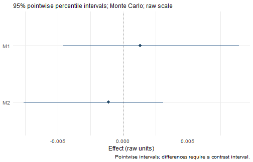
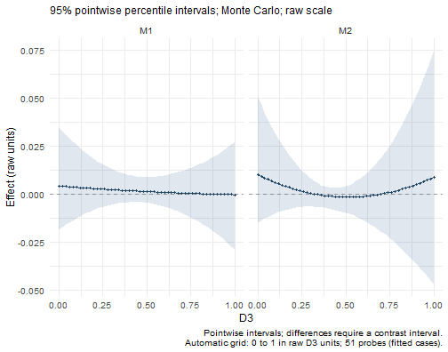

Learn the basic workflow through two examples: parallel mediation, followed
by moderated mediation. Both use the package's complete simulated data and
start with the default analysis, report and plot. No external data file is needed.

## Install wsMed

These tutorials describe **wsMed 1.2.0**. Install the released package from CRAN:


``` r
install.packages("wsMed")
```

Or install the version on the GitHub `master` branch:


``` r
# install.packages("pak")
pak::pak("Yangzhen1999/wsMed@master")
```

Restart R after updating. `packageVersion("wsMed")` shows the installed version.

## Match your columns to the two conditions

Use **one row per participant**, with separate columns for the two conditions.
In this dataset, A and B are mediators and D is the outcome:

| Role | Condition 1 | Condition 2 |
|---|---|---|
| Mediator A | `A1` | `A2` |
| Mediator B | `B1` | `B2` |
| Outcome D | `D1` | `D2` |


``` r
library(wsMed)
data(example_data)
```

The analysis uses **condition 2 minus condition 1**. List the mediators in the
same order in `M_C1` and `M_C2`; wsMed constructs the difference scores internally.
These simulated variables illustrate the interface.

## Example 1: parallel mediation

### Run the analysis

Only the dataset and paired mediator and outcome columns are required:


``` r
result <- wsMed(
  data = example_data,
  M_C1 = c("A1", "B1"),
  M_C2 = c("A2", "B2"),
  Y_C1 = "D1",
  Y_C2 = "D2"
)
```

The omitted arguments use the package defaults:

| Setting | Default |
|---|---|
| Mediator structure | Parallel mediation (`form = "P"`) |
| Missing data | Listwise deletion (`Na = "DE"`); this dataset is complete |
| Inference | Monte Carlo (`ci_method = "mc"`) with 20,000 draws |
| Confidence level | 95% (`alpha = 0.05`) |
| Reporting scale | Unstandardized (`standardized = FALSE`) |
| Random seed | `seed = 123` |

### Read the results


``` r
print(result)
#> wsMed analysis
#> Model: P | DE | Observations: 100 
#> Effects:
#> wsMed all | raw scale | mc 
#> 95% percentile intervals; 20000 joint draws; SE from effect draws
#> Condition contrast: C2 - C1 
#>                                        Estimate Std. Error  CI lower  CI upper
#> cp: Direct effect                     -0.031795   0.017000 -0.064525  0.001864
#> indirect_1: M1                         0.001311   0.003208 -0.004601  0.008917
#> indirect_2: M2                        -0.001120   0.002570 -0.007617  0.003084
#> total_indirect: Total indirect effect  0.000191   0.004111 -0.008172  0.008783
#> total: Total effect                   -0.031604   0.017015 -0.064740  0.001839
#> Inference draws: 20000 retained of 20000 ; 0 excluded before effect extraction.
#> Use as.data.frame() for the full-precision table and metadata.
#> Post-fit admissibility: 1 of 1 ; excluded rows: 0
```

The report includes the direct effect, the indirect pathways through A (`M1`)
and B (`M2`), their total indirect effect, and the total effect. Read each estimate
together with its SE and CI. The total effect is the direct effect plus the total
indirect effect. An interval containing zero does not establish a zero effect.

To see the effect and path-coefficient tables in a statistical summary, use:


``` r
summary(result)
#> wsMed statistical summary
#> Model: P | Missing: DE | Observations: 100 
#> Effects:
#> wsMed all | raw scale | mc 
#> 95% percentile intervals; 20000 joint draws; SE from effect draws
#> Condition contrast: C2 - C1 
#>                                        Estimate Std. Error  CI lower  CI upper
#> cp: Direct effect                     -0.031795   0.017000 -0.064525  0.001864
#> indirect_1: M1                         0.001311   0.003208 -0.004601  0.008917
#> indirect_2: M2                        -0.001120   0.002570 -0.007617  0.003084
#> total_indirect: Total indirect effect  0.000191   0.004111 -0.008172  0.008783
#> total: Total effect                   -0.031604   0.017015 -0.064740  0.001839
#> Inference draws: 20000 retained of 20000 ; 0 excluded before effect extraction.
#> Use as.data.frame() for the full-precision table and metadata.
#> 
#> Path coefficients:
#>    Estimate Std. Error CI lower CI upper
#> cp -0.03180    0.01700 -0.06453  0.00186
#> b1 -0.04834    0.09555 -0.23422  0.13918
#> d1 -0.06905    0.09508 -0.25772  0.11690
#> b2 -0.07732    0.09387 -0.26459  0.10461
#> d2 -0.03676    0.08692 -0.20641  0.13385
#> a1 -0.02712    0.01772 -0.06242  0.00737
#> a2  0.01448    0.01796 -0.02033  0.04929
#> Post-fit admissibility: 1 of 1 ; excluded rows: 0 
#> Tables: $effects, $coefficients; analysis settings: $info.
```

These calls use the stored analysis; they do not fit the model again. You do not
need to select table columns or write formatting code to read the results.

### Plot the indirect effects


``` r
plot(result)
```



The default plot shows the specific indirect effects and their CIs. A point is
an estimate and a horizontal line is its interval.

## Example 2: add a continuous moderator

Keep the same mediator and outcome columns, and add `D3` as the moderator.
Here `MP` allows both mediator-to-outcome difference slopes (`b1` and `b2`)
to vary with the moderator. Moderator main effects are included automatically.


``` r
moderated <- wsMed(
  data = example_data,
  M_C1 = c("A1", "B1"),
  M_C2 = c("A2", "B2"),
  Y_C1 = "D1",
  Y_C2 = "D2",
  W = "D3",
  MP = c("b1", "b2")
)
```

### Read the conditional effects


``` r
print(moderated)
#> wsMed analysis
#> Model: P | DE | Observations: 100 
#> Effects:
#> wsMed all | raw scale | mc 
#> 95% percentile intervals; 20000 joint draws; SE from effect draws
#> Condition contrast: C2 - C1 
#> Moderator: D3 in raw units; centering reference = 0.452271 
#>                                                       Estimate Std. Error
#> cp@1: Direct effect [D3 = 0.452]                     -0.034124   0.016983
#> indirect_1@1: M1 [D3 = 0.452]                         0.001505   0.003187
#> indirect_2@1: M2 [D3 = 0.452]                        -0.001426   0.002821
#> total_indirect@1: Total indirect effect [D3 = 0.452]  0.000079   0.004260
#> total@1: Total effect [D3 = 0.452]                   -0.034045   0.017063
#>                                                       CI lower  CI upper
#> cp@1: Direct effect [D3 = 0.452]                     -0.067146 -0.000556
#> indirect_1@1: M1 [D3 = 0.452]                        -0.004314  0.008981
#> indirect_2@1: M2 [D3 = 0.452]                        -0.008533  0.003150
#> total_indirect@1: Total indirect effect [D3 = 0.452] -0.008900  0.008848
#> total@1: Total effect [D3 = 0.452]                   -0.067365 -0.000430
#> Inference draws: 20000 retained of 20000 ; 0 excluded before effect extraction.
#> Use as.data.frame() for the full-precision table and metadata.
#> Post-fit admissibility: 1 of 1 ; excluded rows: 0
```

With a continuous moderator, the default report evaluates effects at its
centering reference, the fitted-sample mean for this complete dataset. The
report identifies that value. These are effects at that reference, not averages
of effects across participants.

### Plot how the indirect effects change


``` r
plot(moderated)
```



The default plot now shows conditional indirect-effect curves across the observed
moderator range. The horizontal axis uses the moderator's original units, and
the bands are pointwise CIs. No additional plotting settings are required.

## Specify more only when you need it

The first call can also be written with its settings explicitly stated:


``` r
result <- wsMed(
  data = example_data,
  M_C1 = c("A1", "B1"),
  M_C2 = c("A2", "B2"),
  Y_C1 = "D1",
  Y_C2 = "D2",
  form = "P",
  Na = "DE",
  ci_method = "mc",
  R = 20000,
  alpha = 0.05,
  seed = 123,
  standardized = FALSE
)
```

This is equivalent to the minimal call in Example 1. Change an argument when
your analysis needs a different model, missing-data strategy or inference method.
The [analysis guide](AnalysisGuide.html) explains those choices.

For a particular reporting question, add an option to the default report:


``` r
# Request standardized results without fitting again.
summary(
  result,
  standardized = TRUE
)

# Evaluate the moderated model at a chosen raw moderator value.
print(
  moderated,
  at = list(D3 = mean(example_data$D3))
)
```

## Continue with your own analysis

| Your next task | Guide |
|---|---|
| Choose serial or user-defined pathways | [Choose an analysis](AnalysisGuide.html#choose-your-model) |
| Add covariates or handle missing data | [Analysis options](WsMed.html) |
| Work with categorical predictors | [Categorical predictors](CategoricalPredictors.html) |
| Select effects, standardize or export results | [Read and export results](ResultsGuide.html) |
| Customize a figure | [Plot gallery](PlottingEffects.html) |
| Specify, fit and inspect a model in separate steps | [Staged workflow](ModularWorkflow.html) |

The empirical data used in the manuscript are also available as `wsmed_examples`;
see `help("wsmed_examples")` for their source and variable definitions.
