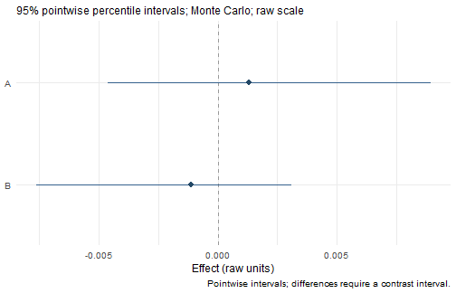
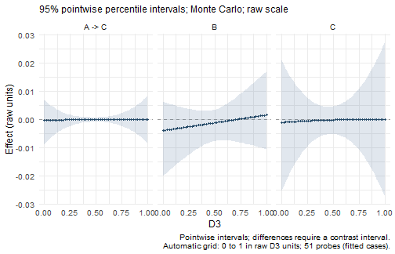

The staged interface separates model specification, fitting, and inference.
You can inspect the output after each stage and reuse it in the next one.
This guide follows one parallel-mediation example through those three stages,
then shows how to read and extract the results. `wsMed()` remains available
for completing the analysis in one call, as shown in [Get started](GetStarted.html).

## The workflow at a glance

| Stage and call | Returned object | What is available |
|---|---|---|
| **1. Specify**<br>`wsmed_model()` | `model`: a `wsmed_model` | Variable pairs, condition order, mediator structure, covariates and moderator settings. |
| **2. Fit**<br>`wsmed_fit(model, data)` | `fit`: a `wsmed_fit` | Fitted parameters and native SEs, prepared data, model syntax, backend fits and diagnostics. |
| **3. Infer**<br>`wsmed_infer(fit)` | `inference`: a `wsmed_inference` | The original fit, joint draws, inference settings and draw diagnostics. |
| **4. Read or extract**<br>`summary(inference)` or `wsmed_effects(inference)` | A summary or `wsmed_results` | Effect estimates, SEs, CIs, effect draws and reporting settings. |

The first three steps create the analysis objects. The fourth uses those
objects to produce tables, plots and contrasts; it does not fit or sample again.
At each step below, start with the default display and use the extraction
examples only when you need the underlying values.


``` r
data(example_data)
```

These simulated data are complete and in wide format, with one row per
participant. A1/A2 and B1/B2 are the mediator pairs; D1/D2 are the outcome pair.

## 1. Specify the model

Use `wsmed_model()` to describe the analysis before supplying data. Name each
pair with the same two conditions. Here, every difference is **after minus
before**. The names A and B identify the mediator roles in paths and output.


``` r
model <- wsmed_model(
  outcome = c(before = "D1", after = "D2"),
  mediators = list(
    A = c(before = "A1", after = "A2"),
    B = c(before = "B1", after = "B2")
  )
)
print(model)
#> wsMed model: P 
#> Difference: after - before 
#> Mediators: A, B
```

Parallel mediation is the default. The main specification arguments are:

| Argument | What it specifies |
|---|---|
| `outcome` | A named pair of outcome columns. Its order defines the condition contrast. |
| `mediators` | A named list of mediator pairs. Order determines mediator numbering. |
| `structure` | `"parallel"`, `"serial"`, `"serial_parallel"`, `"parallel_serial"`, or `"custom"`. |
| `paths` | For custom models, arrows using mediator role names and `Y`, such as `"A -> B"` and `"B -> Y"`. |
| `covariates` | A list with `between` column names and/or `within` named pairs. |
| `moderator` | A list specifying the moderator column and the paths with interactions. |

### What can you inspect now?


``` r
specification <- wsmed_inspect(model, "model")
specification$conditions
#> [1] "before" "after"
specification$mediator_names
#> [1] "A" "B"
column_map <- specification$input_vars
```

| Item | Access |
|---|---|
| Complete specification | `wsmed_inspect(model, "model")` |
| Condition names and order | `model$conditions` |
| Mediator role names | `model$mediator_names` |
| Paired columns and predictor settings | `model$input_vars` |
| Model-form code and custom edges | `model$form`, `model$paths` |

This object contains no observations, fitted estimates or CIs. Model syntax,
transformed data and fit diagnostics become available after fitting.

## 2. Fit the model

Pass the specification and the wide dataset to `wsmed_fit()`:


``` r
fit <- wsmed_fit(
  model,
  data = example_data
)
print(fit)
#> wsMed fit: P | DE | 1 fitted dataset(s)
#> Observations: 100 of 100 input rows
#> Converged: 1 of 1 
#> Condition contrast: after - before 
#> Post-fit admissibility: 1 of 1 ; excluded rows: 0
```

`print(fit)` reports the sample size, convergence and diagnostic summary.
The fitting default is `missing = "error"`, so missing analysis values require
an explicit choice of `"listwise"`, `"fiml"`, or `"mi"`. This differs from
the listwise-deletion default of `wsMed()`; it makes no difference for the
complete data used here. Missing-data examples appear below.

For the fitted parameter estimates and their native SEs:


``` r
fit_summary <- summary(fit)
print(fit_summary)
#> wsMed fitted parameters (DE)
#> Standard errors from fitted parameter covariance; confidence intervals require inference.
#> Condition contrast: after - before 
#> Post-fit admissibility: 1 of 1 ; excluded rows: 0 
#>                 Estimate Std. Error
#> cp             -3.18e-02   1.70e-02
#> b1             -4.83e-02   9.56e-02
#> d1             -6.91e-02   9.52e-02
#> b2             -7.73e-02   9.33e-02
#> d2             -3.68e-02   8.68e-02
#> a1             -2.71e-02   1.75e-02
#> a2              1.45e-02   1.80e-02
#> Ydiff~~Ydiff    2.81e-02   3.97e-03
#> M1diff~~M1diff  3.08e-02   4.35e-03
#> M2diff~~M2diff  3.23e-02   4.56e-03
#> M1avg~~M1avg    3.39e-02   4.79e-03
#> M1avg~~M2avg    1.08e-02   3.87e-03
#> M2avg~~M2avg    4.07e-02   5.76e-03
#> M1avg~1        -2.22e-18   1.84e-02
#> M2avg~1         3.22e-17   2.02e-02
```

These are the SEM's fitted parameters, including regression coefficients,
intercepts and variances. Their SEs come from the fitted parameter covariance
matrix, or Rubin pooling after MI. They are available before simulation.

### What can you extract from the fit?

| Item | Access | Returned value |
|---|---|---|
| Parameter estimates | `coef(fit)` | Named numeric vector. |
| Parameter estimates and native SEs | `fit_summary$coefficients` | Numeric matrix. |
| Parameter covariance | `vcov(fit)` | Covariance matrix; Rubin-pooled after MI. |
| Number of fitted observations | `nobs(fit)` | One count per fitted dataset. |
| Generated model syntax | `wsmed_inspect(fit, "syntax")` | Character string. |
| Prepared analysis variables | `wsmed_inspect(fit, "data")` | Data frame of differences, centered averages and other required variables. |
| Backend models | `wsmed_inspect(fit, "fits")` | List of lavaan fits; one per imputation for MI. |
| Fit checks and warnings | `wsmed_inspect(fit, "diagnostics")` | Diagnostic list, including a `by_dataset` table. |
| Recorded fitting information | `wsmed_inspect(fit, "provenance")` | Recorded software and fitting metadata. |

For example, save the estimates, covariance and prepared data for further work:


``` r
parameter_estimates <- coef(fit)
parameter_covariance <- vcov(fit)
prepared_data <- wsmed_inspect(fit, "data")
nobs(fit)
#> [1] 100
head(prepared_data)
#>         Ydiff     M1diff      M2diff      M1avg       M2avg
#> 1 -0.21677139 -0.1722935  0.16068969 -0.1000090 -0.35166874
#> 2  0.39173048 -0.2088457  0.06815762 -0.3091593 -0.23200291
#> 3  0.37078168 -0.0395939  0.04733066 -0.3458011 -0.20683550
#> 4 -0.09494456 -0.3903959 -0.17175804 -0.1643716  0.01018087
#> 5 -0.10497217  0.2522317 -0.20559112  0.1062956  0.02496926
#> 6 -0.14741498 -0.1956271 -0.04948771  0.1311617  0.21555420
```

Inspect the generated equations and check the fitted datasets:


``` r
cat(wsmed_inspect(fit, "syntax"))
#> Ydiff ~ cp*1 + b1*M1diff + d1*M1avg + b2*M2diff + d2*M2avg
#> M1diff ~ a1*1
#> M2diff ~ a2*1
#> indirect_1 := a1 * b1
#> indirect_2 := a2 * b2
#> total_indirect := indirect_1 + indirect_2
#> total_effect := cp + total_indirect
fit_checks <- wsmed_inspect(fit, "diagnostics")
fit_checks$by_dataset[c("dataset", "n.used", "converged", "admissible", "warnings")]
#>   dataset n.used converged admissible warnings
#> 1       1    100      TRUE       TRUE        0
fit_checks$warnings
#> character(0)
```

`converged` records whether estimation converged; `admissible` records the
backend post-fit check. Review warnings and failed checks before proceeding.
Convergence alone does not establish that the model or missing-data assumptions
are appropriate. For additional backend diagnostics, retrieve the fits with
`wsmed_inspect(fit, "fits")` and inspect the relevant fitted dataset.

You can also obtain effect **point estimates** before inference:


``` r
point_effects <- wsmed_effects(fit)
print(point_effects)
#> wsMed indirect | raw scale | point 
#> Point estimates only; no simulation-based SE or intervals.
#> Condition contrast: after - before 
#>               Estimate
#> indirect_1: A  0.00131
#> indirect_2: B -0.00112
#> Use as.data.frame() for the full-precision table and metadata.
```

This defaults to the specific indirect effects. No simulation-based effect
SEs or CIs are available yet. `confint(fit)` therefore asks you to run
`wsmed_infer()` first; `plot(fit)` likewise shows point estimates only.

## 3. Perform inference

Pass the existing fit to `wsmed_infer()`:


``` r
inference <- wsmed_infer(
  fit,
  seed = 123
)
print(inference)
#> wsMed inference: mc | 20000 valid draws of 20000 requested
#> 95% effect intervals: percentile; stored parameter-table convention: percentile
#> Inference draws: 20000 retained of 20000 ; 0 excluded before effect extraction.
#> Use summary() or wsmed_effects() to select effects.
```

The defaults are Monte Carlo inference, 20,000 draws and 95% CIs. The seed
is specified for reproducibility; the staged default is `seed = NULL`.
`print(inference)` reports the inference method and the number of retained
draws. It does not display the effect table; use `summary(inference)` next.

### What can you extract from inference?

| Item | Access | Meaning |
|---|---|---|
| Original fitted model | `inference$fit` | The `wsmed_fit` supplied to this stage. |
| Joint draws | `inference$draws` | One draw per row; columns contain parameters and generated effect definitions. |
| Draw identities | `inference$draw_ids` | Original identities of retained draws. |
| Method and settings | `inference$method`, `inference$controls` | Draw count, seed, confidence level and other inference controls. |
| Inference checks | `wsmed_inspect(inference, "diagnostics")` | Requested, retained and invalid draws, plus recorded warnings. |
| Parameter point estimates | `coef(inference)` | The same fitted parameter estimates as `coef(fit)`. |
| Empirical parameter covariance | `vcov(inference)` | Covariance of stored draws for the model parameters. |
| Parameter CIs | `confint(inference)` | Percentile CIs for model parameters. |

For a compact view of the stored joint draws:


``` r
joint_draws <- inference$draws
dim(joint_draws)
#> [1] 20000    19
head(
  joint_draws[, c("a1", "b1", "indirect_1")],
  n = 3
)
#>                a1          b1    indirect_1
#> [1,] -0.003646698  0.03051870 -0.0001112925
#> [2,] -0.008944494 -0.02753057  0.0002462470
#> [3,] -0.011483156  0.15272658 -0.0017537831
inference_checks <- wsmed_inspect(inference, "diagnostics")
inference_checks[c("requested", "valid", "invalid")]
#> $requested
#> [1] 20000
#> 
#> $valid
#> [1] 20000
#> 
#> $invalid
#> [1] 0
```

The coefficients within a row belong to the same draw. Keeping that pairing
is necessary when forming products or contrasts. Point estimates remain those
computed from the fitted model; they are not replaced by averages of the draws.
For conditional or standardized effect draws, use the result object in step 4,
which applies the requested transformations and records any additional exclusions.

`wsmed_inspect(inference, "diagnostics")` describes inference. To recover
the fitting checks, use `wsmed_inspect(inference$fit, "diagnostics")`.

## 4. Read and extract effect results

Start with the default statistical summary and plot:


``` r
s <- summary(inference)
print(s)
#> wsMed statistical summary
#> Model: P | Missing: DE | Observations: 100 
#> Effects:
#> wsMed all | raw scale | mc 
#> 95% percentile intervals; 20000 joint draws; SE from effect draws
#> Condition contrast: after - before 
#>                                        Estimate Std. Error  CI lower  CI upper
#> cp: Direct effect                     -0.031795   0.017000 -0.064525  0.001864
#> indirect_1: A                          0.001311   0.003208 -0.004601  0.008917
#> indirect_2: B                         -0.001120   0.002570 -0.007617  0.003084
#> total_indirect: Total indirect effect  0.000191   0.004111 -0.008172  0.008783
#> total: Total effect                   -0.031604   0.017015 -0.064740  0.001839
#> Inference draws: 20000 retained of 20000 ; 0 excluded before effect extraction.
#> Use as.data.frame() for the full-precision table and metadata.
#> 
#> Path coefficients:
#>    Estimate Std. Error CI lower CI upper
#> cp -0.03180    0.01700 -0.06453  0.00186
#> b1 -0.04834    0.09555 -0.23422  0.13918
#> d1 -0.06905    0.09508 -0.25772  0.11690
#> b2 -0.07732    0.09387 -0.26459  0.10461
#> d2 -0.03676    0.08692 -0.20641  0.13385
#> a1 -0.02712    0.01772 -0.06242  0.00737
#> a2  0.01448    0.01796 -0.02033  0.04929
#> Post-fit admissibility: 1 of 1 ; excluded rows: 0 
#> Tables: $effects, $coefficients; analysis settings: $info.
```


``` r
plot(inference)
```



The summary displays the direct effect, specific indirect effects, total
indirect effect and total effect, followed by path coefficients. The default
plot displays the specific indirect effects. Each effect SE is the sample SD
of its draws, and its CI is a percentile interval from those draws.

### What can you extract from the summary?

| Item | Access |
|---|---|
| Effect table: estimates, SEs, CIs and metadata | `s$effects` or `as.data.frame(s)` |
| Path-coefficient table | `s$coefficients` |
| Reporting settings: method, scale, confidence level and probes | `s$info` |
| Selected effect estimates | `coef(s)` |
| Selected effect CIs | `confint(s)` |
| Covariance of selected effect draws | `vcov(s)` |
| Joint draws for the selected effects | `s$draws` |
| Draw identities and effect-level exclusions | `s$draw_ids`, `s$diagnostics` |
| Fitting diagnostics retained in the summary | `s$fit_diagnostics` |

For example, retain just the effect name, estimate, SE and CI columns:


``` r
effect_table <- as.data.frame(s)
columns <- c(
  "label",
  "estimate",
  "std.error",
  "conf.low",
  "conf.high"
)
effect_table[, columns]
#>                   label      estimate   std.error     conf.low   conf.high
#> 1         Direct effect -0.0317954295 0.016999696 -0.064525051 0.001863739
#> 2                     A  0.0013113045 0.003207828 -0.004600745 0.008917406
#> 3                     B -0.0011199168 0.002569908 -0.007616873 0.003084259
#> 4 Total indirect effect  0.0001913877 0.004111147 -0.008172032 0.008783391
#> 5          Total effect -0.0316040417 0.017015460 -0.064739552 0.001838718
```

Remove names from `columns` to omit them, or reorder them to change the display.
The same selection works on `s$coefficients`. Tables retain full precision;
the `digits` argument to `print()` changes only the display.

The object passed to an accessor determines what it returns:

| Call | Quantity |
|---|---|
| `coef(fit)` or `coef(inference)` | Fitted SEM parameters. |
| `vcov(fit)` | Native fitted parameter covariance. |
| `vcov(inference)` | Empirical covariance of model-parameter draws. |
| `confint(inference)` | CIs for model parameters. |
| `coef(s)`, `vcov(s)`, `confint(s)` | Estimates, draw covariance and CIs for the effects selected in the summary. |

For indirect-effect CIs, use a summary or an effect result object, rather
than `confint(inference)`. For example:


``` r
effects <- wsmed_effects(inference)
print(effects)
#> wsMed indirect | raw scale | mc 
#> 95% percentile intervals; 20000 joint draws; SE from effect draws
#> Condition contrast: after - before 
#>               Estimate Std. Error CI lower CI upper
#> indirect_1: A  0.00131    0.00321 -0.00460  0.00892
#> indirect_2: B -0.00112    0.00257 -0.00762  0.00308
#> Inference draws: 20000 retained of 20000 ; 0 excluded before effect extraction.
#> Use as.data.frame() for the full-precision table and metadata.
confint(effects)
#>                   2.5 %      97.5 %
#> indirect_1 -0.004600745 0.008917406
#> indirect_2 -0.007616873 0.003084259
```

`wsmed_effects()` defaults to specific indirect effects. Its `wsmed_results`
object stores `$table`, `$point`, `$draws`, `$draw_ids`, `$query`, and
`$diagnostics`. `$query` records the requested effect family, reporting scale,
moderator values and confidence level. In contrast, `summary()` defaults to
all core effects and adds the path-coefficient table and `$info`.

To compare the two indirect effects, use the same joint draws:


``` r
contrast <- wsmed_contrasts(
  effects,
  list(B_minus_A = c(indirect_2 = 1, indirect_1 = -1))
)
print(contrast)
#> wsMed contrasts | raw scale | mc 
#> 95% percentile intervals; 20000 joint draws; SE from effect draws
#> Condition contrast: after - before 
#> Contrast direction (signed weights):
#>  B_minus_A: +1 * B -1 * A
#>           Estimate Std. Error CI lower CI upper
#> B_minus_A -0.00243    0.00411 -0.01178  0.00492
#> Inference draws: 20000 retained of 20000 ; 0 excluded before effect extraction.
#> Use as.data.frame() for the full-precision table and metadata.
```

The contrast CI comes from the draw-by-draw difference, not from subtracting
the endpoints of two separate CIs. See [Read and export results](ResultsGuide.html)
for further selection and export examples.

## Decide where to restart after a change

| What changed? | Where to continue |
|---|---|
| Variable roles, mediator structure, covariates or moderated paths | Specify a new model, then fit and infer. |
| Dataset, missing-data strategy or imputation settings | Run `wsmed_fit()` with the relevant model, then infer. |
| Monte Carlo versus bootstrap, number of draws, or inference seed | Run `wsmed_infer()` on the existing fit. |
| Selected effects, moderator probes, confidence level or reporting scale | Query the existing inference or result object. |
| Labels, rounding or plot appearance | Reprint or replot existing results. |

For example, the following queries reuse the same inference draws:


``` r
summary(
  effects,
  level = 0.90
)
#> wsMed indirect | raw scale | mc 
#> 90% percentile intervals; 20000 joint draws; SE from effect draws
#> Condition contrast: after - before 
#>               Estimate Std. Error CI lower CI upper
#> indirect_1: A  0.00131    0.00321 -0.00328  0.00721
#> indirect_2: B -0.00112    0.00257 -0.00602  0.00213
#> Inference draws: 20000 retained of 20000 ; 0 excluded before effect extraction.
#> Use as.data.frame() for the full-precision table and metadata.
summary(
  inference,
  standardized = TRUE
)
#> wsMed statistical summary
#> Model: P | Missing: DE | Observations: 100 
#> Effects:
#> wsMed all | marginal scale | mc 
#> 95% percentile intervals; 20000 joint draws; SE from effect draws
#> Condition contrast: after - before 
#> Standardization: effect / marginal model-implied SD(D2 - D1); condition contrast is unscaled.
#> Plug-in marginal outcome-difference SD: 0.169239 
#> The denominator is not a moderator-specific conditional SD.
#>                                       Estimate Std. Error CI lower CI upper
#> cp: Direct effect                     -0.18787    0.10051 -0.38202  0.01096
#> indirect_1: A                          0.00775    0.01858 -0.02674  0.05159
#> indirect_2: B                         -0.00662    0.01480 -0.04360  0.01801
#> total_indirect: Total indirect effect  0.00113    0.02378 -0.04770  0.05070
#> total: Total effect                   -0.18674    0.10054 -0.38189  0.01043
#> Inference draws: 20000 retained of 20000 ; 0 excluded before effect extraction.
#> Use as.data.frame() for the full-precision table and metadata.
#> 
#> Path coefficients:
#>    Estimate Std. Error CI lower CI upper
#> cp  -0.1879     0.1005  -0.3820   0.0110
#> b1  -0.0501     0.0972  -0.2381   0.1427
#> d1  -0.0751     0.1012  -0.2724   0.1253
#> b2  -0.0821     0.0973  -0.2710   0.1092
#> d2  -0.0438     0.1014  -0.2392   0.1566
#> a1  -0.1546     0.1026  -0.3598   0.0419
#> a2   0.0806     0.1013  -0.1133   0.2817
#> Post-fit admissibility: 1 of 1 ; excluded rows: 0 
#> Tables: $effects, $coefficients; analysis settings: $info.
```

Alternatively, set `standardized = TRUE` in `wsmed_fit()` to save standardized
reporting as the default. This does not change model fitting. Standardized
effects use the model-implied scales and propagate their uncertainty across
the joint draws; see [standardized effects](StandardizedModeratedMediation.html).

To create a separate bootstrap inference from the same fit:


``` r
bootstrap_inference <- wsmed_infer(
  fit,
  method = "bootstrap",
  seed = 123
)
summary(bootstrap_inference)
```

This uses the default 2,000 bootstrap replicates. Bootstrap necessarily fits
the resampled datasets; it retains the original fitted object. The `interval`
argument controls the stored legacy parameter table. Effect and `confint()`
methods use percentile intervals, including when that parameter table uses
a bias-corrected convention.

## Add a custom structure and moderator

Changes to the model belong in step 1. In the staged interface, custom arrows
and moderated slopes use the **mediator role names**, rather than the
`M1`/`M2` and `MP` labels used by `wsMed()`. The following model has A to C,
C to the outcome, and B to the outcome, with moderation of the first two slopes:


``` r
moderated_model <- wsmed_model(
  outcome = c(before = "D1", after = "D2"),
  mediators = list(
    A = c(before = "A1", after = "A2"),
    B = c(before = "B1", after = "B2"),
    C = c(before = "C1", after = "C2")
  ),
  structure = "custom",
  paths = c("A -> C", "C -> Y", "B -> Y"),
  moderator = list(
    variable = "D3",
    interactions = c("A -> C", "C -> Y")
  )
)
mod_fit <- wsmed_fit(
  moderated_model,
  data = example_data
)
mod_inference <- wsmed_infer(
  mod_fit,
  seed = 123
)
summary(mod_inference)
#> wsMed statistical summary
#> Model: UD | Missing: DE | Observations: 100 
#> Effects:
#> wsMed all | raw scale | mc 
#> 95% percentile intervals; 20000 joint draws; SE from effect draws
#> Condition contrast: after - before 
#> Moderator: D3 in raw units; centering reference = 0.452271 
#>                                                       Estimate Std. Error
#> cp@1: Direct effect [D3 = 0.452]                     -0.029850   0.016991
#> indirect_1_3@1: A -> C [D3 = 0.452]                  -0.000022   0.000370
#> indirect_2@1: B [D3 = 0.452]                         -0.001400   0.002744
#> indirect_3@1: C [D3 = 0.452]                         -0.000183   0.002197
#> total_indirect@1: Total indirect effect [D3 = 0.452] -0.001605   0.003579
#> total@1: Total effect [D3 = 0.452]                   -0.031455   0.017156
#>                                                       CI lower  CI upper
#> cp@1: Direct effect [D3 = 0.452]                     -0.063464  0.003220
#> indirect_1_3@1: A -> C [D3 = 0.452]                  -0.000859  0.000693
#> indirect_2@1: B [D3 = 0.452]                         -0.008152  0.003015
#> indirect_3@1: C [D3 = 0.452]                         -0.005197  0.004528
#> total_indirect@1: Total indirect effect [D3 = 0.452] -0.009654  0.004942
#> total@1: Total effect [D3 = 0.452]                   -0.065283  0.002200
#> Inference draws: 20000 retained of 20000 ; 0 excluded before effect extraction.
#> Use as.data.frame() for the full-precision table and metadata.
#> 
#> Path coefficients:
#>                             Estimate Std. Error CI lower CI upper
#> cp@1: cp [D3 = 0.452]       -0.02985    0.01699 -0.06346  0.00322
#> b2@1: b2 [D3 = 0.452]       -0.09668    0.09286 -0.27706  0.08467
#> d2@1: d2 [D3 = 0.452]       -0.00641    0.08965 -0.18213  0.16842
#> b3@1: b3 [D3 = 0.452]       -0.01370    0.10379 -0.21420  0.19224
#> d3@1: d3 [D3 = 0.452]       -0.15680    0.10278 -0.35544  0.04381
#> a1@1: a1 [D3 = 0.452]       -0.02712    0.01728 -0.06096  0.00686
#> a2@1: a2 [D3 = 0.452]        0.01448    0.01791 -0.02029  0.04996
#> a3@1: a3 [D3 = 0.452]        0.01336    0.01623 -0.01839  0.04501
#> b_1_3@1: b_1_3 [D3 = 0.452] -0.05915    0.09217 -0.23830  0.12335
#> d_1_3@1: d_1_3 [D3 = 0.452] -0.05761    0.09043 -0.23386  0.11835
#> Post-fit admissibility: 1 of 1 ; excluded rows: 0 
#> Tables: $effects, $coefficients; analysis settings: $info.
```

`interactions` selects difference-component slopes. To moderate an
average-component slope, use `average_interactions` in the moderator list.
Moderator main effects enter all difference equations by default.
This example corresponds to `form = "UD"` with
`paths = c("M1 -> M3", "M3 -> Y", "M2 -> Y")` and
`MP = c("b_1_3", "b3")` in the [one-call UD tutorial](GenerateModelCustom.html#add-a-moderator).

The same extraction functions remain available at each stage. For example,
`wsmed_inspect(mod_fit, "syntax")` shows the fitted interaction terms, and
`summary(mod_inference)$coefficients` contains conditional path coefficients.
The default continuous-moderator summary uses the centering reference shown
in the output; the default plot displays indirect effects across its range:


``` r
plot(mod_inference)
```



To choose raw moderator values and retain a conditional-effect table:


``` r
conditional <- wsmed_effects(
  mod_inference,
  at = list(D3 = c(0.2, 0.4, 0.6))
)
print(conditional)
#> wsMed indirect | raw scale | mc 
#> 95% percentile intervals; 20000 joint draws; SE from effect draws
#> Condition contrast: after - before 
#> Moderator: D3 in raw units; centering reference = 0.452271 
#>                                    Estimate Std. Error  CI lower  CI upper
#> indirect_1_3@1: A -> C [D3 = 0.2] -1.21e-04   1.25e-03 -3.04e-03  2.27e-03
#> indirect_2@1: B [D3 = 0.2]        -2.79e-03   4.45e-03 -1.38e-02  4.15e-03
#> indirect_3@1: C [D3 = 0.2]        -5.60e-04   4.95e-03 -1.17e-02  9.60e-03
#> indirect_1_3@2: A -> C [D3 = 0.4] -3.54e-05   4.29e-04 -1.04e-03  8.05e-04
#> indirect_2@2: B [D3 = 0.4]        -1.69e-03   2.94e-03 -8.96e-03  2.92e-03
#> indirect_3@2: C [D3 = 0.4]        -2.44e-04   2.37e-03 -5.59e-03  4.70e-03
#> indirect_1_3@3: A -> C [D3 = 0.6] -3.81e-07   4.69e-04 -9.86e-04  9.52e-04
#> indirect_2@3: B [D3 = 0.6]        -5.86e-04   2.90e-03 -7.41e-03  5.16e-03
#> indirect_3@3: C [D3 = 0.6]        -5.77e-05   2.75e-03 -6.11e-03  6.00e-03
#> Inference draws: 20000 retained of 20000 ; 0 excluded before effect extraction.
#> Use as.data.frame() for the full-precision table and metadata.
```

`conditional$table` contains the estimates and CIs at those values;
`conditional$draws` contains the corresponding joint effect draws.
Supply raw values even when requesting standardized output. Invalid
standardized draws are excluded jointly, with original identities recorded
in `$diagnostics$invalid_draw_ids`. Plot bands are pointwise, not simultaneous.

For categorical covariates and moderators, use unordered factors with explicit
levels; the first level is the reference group. Numeric 0/1 columns remain
continuous in the staged interface unless converted to factors. Default
categorical probes include all observed levels. See
[categorical predictors](CategoricalPredictors.html) for coding and group contrasts.

## Handle missing data at the fitting stage

The model specification can be reused with incomplete data. To demonstrate,
remove a few measurements from a copy of the simulated data:


``` r
incomplete_data <- example_data
incomplete_data$A2[1:5] <- NA
incomplete_data$D2[6:10] <- NA
```

| `missing` | What fitting does | Inference methods |
|---|---|---|
| `"error"` (default) | Requires complete analysis variables. | Monte Carlo or bootstrap. |
| `"listwise"` | Uses complete cases for the analysis variables. | Monte Carlo or bootstrap. |
| `"fiml"` | Handles missing analysis variables during model fitting. | Monte Carlo or bootstrap. |
| `"mi"` | Imputes original measurements, constructs variables within each completed dataset, fits and pools. | Monte Carlo only. |

For FIML, use `wsmed_fit(model, incomplete_data, missing = "fiml")`.
Categorical predictors must be fully observed under FIML. For MI, set its
controls at fitting and the inference seed separately:


``` r
mi_fit <- wsmed_fit(
  model,
  data = incomplete_data,
  missing = "mi",
  mi = list(seed = 123)
)
mi_inference <- wsmed_infer(
  mi_fit,
  seed = 604
)
print(mi_fit)
#> wsMed fit: P | MI | 5 fitted dataset(s)
#> Observations: 100 of 100 input rows
#> Converged: 5 of 5 
#> Condition contrast: after - before 
#> MI: per-imputation centering; first-imputation reporting reference.
#> Post-fit admissibility: 5 of 5 ; excluded rows: 0
print(mi_inference)
#> wsMed inference: mc | 20000 valid draws of 20000 requested
#> 95% effect intervals: percentile; stored parameter-table convention: percentile
#> Inference draws: 20000 retained of 20000 ; 0 excluded before effect extraction.
#> Use summary() or wsmed_effects() to select effects.
```

This uses the default five imputations and numeric imputation method. Choose
appropriate settings for an actual analysis; for example,
`mi = list(m = 20, method = "pmm", seed = 123)` explicitly requests 20
predictive-mean-matching imputations. A new `wsmed_infer(mi_fit, ...)` call
reuses the fitted imputations and pooled quantities without reimputing.

### What changes in extraction after MI?

| Item | Access |
|---|---|
| Pooled parameter estimates and total covariance | `coef(mi_fit)`, `vcov(mi_fit)` |
| All backend fits | `wsmed_inspect(mi_fit, "fits")` |
| Counts and checks for every imputation | `nobs(mi_fit)`, `wsmed_inspect(mi_fit, "diagnostics")$by_dataset` |
| Prepared data for the first imputation | `wsmed_inspect(mi_fit, "data")` |
| Prepared data for all imputations | `mi_fit$mi$prepared$processed_data_list` |
| Pooled effect summaries and their draws | `summary(mi_inference)`, `wsmed_effects(mi_inference)` |

For example, retrieve the fitted models and transformed datasets:


``` r
imputation_fits <- wsmed_inspect(mi_fit, "fits")
prepared_imputations <- mi_fit$mi$prepared$processed_data_list
length(imputation_fits)
#> [1] 5
length(prepared_imputations)
#> [1] 5
nobs(mi_fit)
#> [1] 100 100 100 100 100
```

`wsmed_inspect(mi_fit, "data")` returns one data frame, not the complete list
of imputations. Do not use the first imputation's backend fit as a substitute
for pooled inference. The workflow retains per-imputation centering and the
first-imputation moderator reference for reporting.

For externally generated imputations, pass
`mi = list(completed = completed)` with `missing = "mi"`. `completed` can be a
list of completed wide datasets or a `mice` mids object. Their number is
inferred; omit internal imputation-method and seed controls. With moderation,
default main-effects imputation may not preserve the specified interactions.
See [model-compatible imputation](CompatibleImputation.html) for choosing and
supplying an appropriate imputation model.

## Relate the stages to a one-call analysis

For the original complete-data example, the equivalent one-call analysis is:


``` r
result <- wsMed(
  data = example_data,
  M_C1 = c("A1", "B1"),
  M_C2 = c("A2", "B2"),
  Y_C1 = "D1",
  Y_C2 = "D2"
)
print(result)
#> wsMed analysis
#> Model: P | DE | Observations: 100 
#> Effects:
#> wsMed all | raw scale | mc 
#> 95% percentile intervals; 20000 joint draws; SE from effect draws
#> Condition contrast: C2 - C1 
#>                                        Estimate Std. Error  CI lower  CI upper
#> cp: Direct effect                     -0.031795   0.017000 -0.064525  0.001864
#> indirect_1: M1                         0.001311   0.003208 -0.004601  0.008917
#> indirect_2: M2                        -0.001120   0.002570 -0.007617  0.003084
#> total_indirect: Total indirect effect  0.000191   0.004111 -0.008172  0.008783
#> total: Total effect                   -0.031604   0.017015 -0.064740  0.001839
#> Inference draws: 20000 retained of 20000 ; 0 excluded before effect extraction.
#> Use as.data.frame() for the full-precision table and metadata.
#> Post-fit admissibility: 1 of 1 ; excluded rows: 0
```

Both analyses use 20,000 Monte Carlo draws and seed 123. The variable roles are
named differently in the displays, but the numerical effects and draws match
in this example. `wsMed()` uses the same fitting and inference engines.
With missing data, align the missing-data strategy as well as the inference
settings before comparing the interfaces.


## Save a stage and continue later

Save the inference object to retain both its fit and its draws:


``` r
saveRDS(
  inference,
  "mediation-inference.rds"
)
restored <- readRDS("mediation-inference.rds")
summary(restored)
```

Saving `fit` instead retains the fitted model for a later `wsmed_infer()` call.
An analysis manifest records settings, diagnostics and software versions:


``` r
manifest <- wsmed_reproducibility(inference)
names(manifest)
#> [1] "report_schema_version" "model"                 "analysis"             
#> [4] "fitting_versions"      "fit_diagnostics"       "inference"            
#> [7] "export_environment"
```

The manifest does not contain observations or draws and does not replace the
saved object, data and analysis script. Seeded workflow calls restore the
caller's random state; `seed = NULL` advances the current random stream.
For older saved objects, compatibility checks may require refitting or
regenerating inference; the accessors do not silently reconstruct missing
metadata. See [diagnostics and migration](WorkflowReliability.html).
